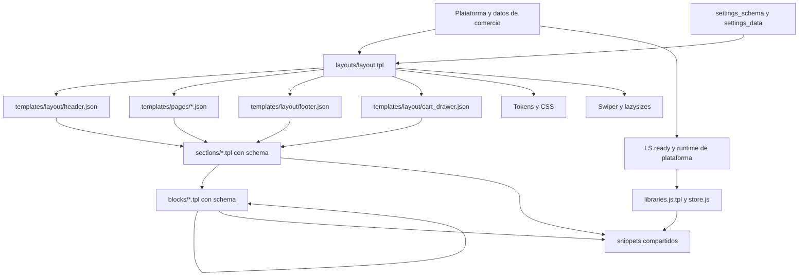

# Arquitectura del sistema

Confirmado el 2026-11-08 mediante [inventario](../13-evidence/measurements/source-baseline/source-summary.json), [grafo](dependency-map.md) y [estado remoto](../13-evidence/measurements/source-baseline/remote-themes.json).

`layouts/` contiene el shell; `templates/layout/` contiene datos de composición. No son rutas intercambiables. Los JSON de página guardan `sections`, `order`, `settings`, `blocks`, `block_order` y eventualmente `disabled`. Cada `type` selecciona un archivo real. Los bloques públicos se habilitan con tags; otros son privados de un padre y algunos son estáticos o no eliminables. [Matriz de editor](../03-editor/sections-and-blocks.md).

El tema usa renderizado servidor mediante Twig. No se encontró una aplicación React/Vue ni un proceso de hidratación de framework en el checkout. Sí existe hidratación específica de carrito mediante `LS.asyncCart` y sustitución de HTML. No deben confundirse estos mecanismos. La presencia de `LS.*`, filtros y componentes privados marca contratos de plataforma que no están implementados por completo en estos archivos.

Los assets se agrupan en tres CSS y tres entradas JS. No hay `package.json`, lockfile, bundler ni tests de storefront en la raíz auditada. Existen herramientas/skills previas en `.agents`, pero no prueban capacidades nativas: por ejemplo, la skill histórica de Embla no establece que Ipanema 1.8.0 use Embla. El archivo local `libraries-standalone.js` identifica Swiper 6.3.2 y lazysizes 5.2.2.

El checkout de compra es una superficie de plataforma con personalizaciones específicas; `static/checkout.scss.tpl` no concede control general de su DOM. El editor y las aplicaciones tienen mecanismos distintos. [Límites](platform-limitations.md).

No se localizó licencia del tema en la raíz auditada ni evidencia de que esté intacto respecto de un release oficial. Git limpio y diff remoto igual solo demuestran consistencia de esta copia con la instalación; no demuestran ausencia histórica de personalizaciones.
