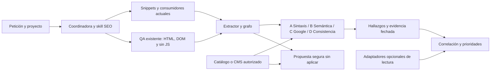

# Motor SEO integrado

Verificado: 2026-11-08. Evoluciona el prototipo de `tools/ipanema/seo/` dentro de V2. [Auditoría y aceptación](../../reports/seo/initial-audit.md) · [resultados](../../reports/seo/evolution-report.md). Requiere Python estándar; navegador opcional reutiliza V2. No instala MCP, inicia OAuth ni escribe en temas.



## Uso cotidiano

Selecciona `--project <id>` antes de `seo`; las rutas de entrada son locales. Las salidas son directorios nuevos en `reports/runs/<id>/`, ignorados por Git, con JSON y Markdown. Un código de salida 1 en audit indica errores detectados; 2 indica entrada/acceso no preparado. Ninguno publica cambios.

```bash
python3 tools/ia.py seo source
python3 tools/ia.py qa --suite page --page category --allow-network
python3 tools/ia.py seo audit --capture /ruta/al/run/browser/category-390-rendered.seo.json
python3 tools/ia.py seo audit --html /ruta/initial.html --rendered /ruta/dom.html --no-js /ruta/nojs.html --url https://tu-tienda.example/categoria/ --type category --status 200
python3 tools/ia.py seo corpus --audit /ruta/home/report.json --audit /ruta/category/report.json --sitemap-urls /ruta/urls-extraidas.json
python3 tools/ia.py qa --suite seo
python3 tools/ia.py seo evals
```

La captura V2 produce `*.seo.json` antes de axe, interacción, máscaras y screenshot. Conserva JSON-LD y marcado público necesario, eliminando scripts ejecutables, valores de formularios y atributos privados conocidos. Es una proyección, no el HTML original íntegro ni un certificado de privacidad. Preserva errores de JSON; no los oculta reparándolos al capturar. Los perfiles `full` incluyen los seis anchos, sin JS y reduced motion. Una captura estática no comprueba todos los eventos o estados.

## Validación y estado

| Nivel | Implementación y prueba | Límite |
|---|---|---|
| A | JSON estricto, comas finales, constantes inválidas, claves repetidas, serialización segura | No es expansión JSON-LD |
| B | Tipos/relaciones y subconjunto fechado de 70 tipos y 111 propiedades del vocabulario oficial, formatos de listas/URLs/precios | RDFa común, microdata sin itemref; propiedades fuera del subconjunto quedan sin comprobar |
| C | Reglas fechadas de snippets, merchant listings, variantes, breadcrumbs, artículos y beta regional opcional | Subconjunto local; requiere políticas de contenido y comprobación externa |
| D | Contraste con catálogo aportado, metadatos, canonical y H1; cada variante con sus propios datos | Sin fuente no se verifica verdad comercial; metadatos tampoco son autoridad independiente |

El informe conserva entidades, relaciones, referencias externas, duplicados candidatos, contradicciones, fuentes candidatas, contenido, rastreo y comparación DOM. Dos scripts complementarios con el mismo `@id` pueden ser correctos. Dos precios incompatibles para una única oferta de la misma entidad justifican investigación; un grupo con variantes de precios diferentes es válido. Repetir un objeto anónimo no demuestra una app duplicada.

Las [reglas Google](../../tools/ipanema/seo/google_requirements.json), [vocabulario fechado](../../tools/ipanema/seo/vocabulary.json) y [contratos nativos de enlaces](../../tools/ipanema/seo/link_contracts.json) son parte de la huella del agente y del QA. Cambiarlos invalida soluciones que necesiten revalidación. Su fecha no acredita sincronización remota ni vigencia indefinida: revisar la documentación oficial antes de decidir y renovar fixtures ante cambios.

## Generación con procedencia

`seo generate --facts /ruta/facts.json --target Product --html /ruta/initial.html` produce una propuesta; `--mode update --entity-id URL#identidad` selecciona una entidad existente. Rechaza JSON-LD nativo inválido, entidades contradictorias, un Product en categoría, otra tienda, fuentes visuales, datos ausentes o variantes sin URLs verificadas. La reparación `seo repair-artifact /ruta/json-roto.json` únicamente quita comas finales cuando ese es todo el defecto; no corrige el snippet original.

El [contrato reutilizable](../../reusable/contracts/seo-evidence.json) exige proyecto/URL, tipo de página, fecha y exportación autorizada local bajo `reports/` con SHA256. El JSON de evidencia contiene `project`, `url` y `data`; `facts.source.reference` apunta a él. `data.product` normaliza nombre, imagen, precio decimal, moneda, URL y campos reales opcionales; `data.article`, `organization`, `breadcrumbs`, `items` y `identifiers` se usan según objetivo. No se deducen GTIN de SKU, stock de un botón ni fecha editorial de la auditoría. Un hash confirma identidad del archivo, no verdad del negocio. `synthetic_fixture` solo existe como opción explícita en tests, nunca en el comando de generación normal.

El generador conserva `@id` al proponer actualización, serializa con escapes seguros y valida el resultado. Los fragmentos `@id` deben venir de una estrategia acordada por tienda; no se inventan por defecto. No añadir la propuesta junto al marcado nativo que reemplaza. Una modificación futura se realiza en la fuente mínima, mediante plan/diff/QA/attempt, sin duplicar cálculos comerciales ni distribuir código propietario.

Fuentes principales: [datos estructurados y matriz](structured-data.md), [categorías](category-seo.md), [PDP](product-seo.md), [home](homepage-seo.md), [blog](blog-seo.md), [carruseles](carousel-seo.md), [Google y MCP](google-integrations.md). La [guía general de Google](https://developers.google.com/search/docs/appearance/structured-data/sd-policies) exige correspondencia con contenido y no garantiza presentación aunque el marcado pase comprobaciones.
