# Orquestador local IA-Ipanema

Este módulo coordina Claude Code y Codex sobre el registro, skills, buscador, contratos y QA existentes. No repite discovery ni incluye un ejecutor de publicación. [Compatibilidad y fuentes](runtime-compatibility.md) · [modelos fechados](../../tools/ipanema/orchestration/models.json) · [verificación](verification.md).

La fase previa para L3/L4 es ahora el [consejo técnico](council.md): dos propuestas independientes, preguntas cruzadas, defensas, matriz de restricciones y ADR. El engine conserva el flujo posterior de implementación/QA/revisión. `--council full` lo activa también en tareas pequeñas; no replica automáticamente tres workers para L1. Un ADR sin evidencia detiene la implementación y nunca autoriza producción.

CommandCode conserva su integración e historial, pero está deshabilitado por `models.json:council`, incluido el fallback y nuevos permisos MCP. La autenticación de Claude y dos recorridos duales reales de solo lectura están verificados. Ambos ADR conservan `needs_evidence`; la deliberación no autoriza implementar. Consulta [resultados y límites comprobados](council-verification.md).

## Inicio

Se necesitan Python/Git y, para ejecutar workers, Linux con Bubblewrap y namespaces operativos. Las CLI de Claude y Codex deben estar instaladas y autenticadas por sus mecanismos propios. No se inicia login ni se instala nada automáticamente; si falta aislamiento, la ejecución se bloquea. Los comandos de configuración/planificación siguen disponibles sin ejecutar modelos. Las pruebas de rutas con espacios se hacen en esta máquina, no equivalen a pruebas en varios sistemas operativos.

```bash
python3 tools/ia.py orchestrate doctor
python3 tools/ia.py orchestrate task "Optimiza el carrusel de categorías en mobile y desktop sin afectar SEO ni rendimiento"
python3 tools/ia.py orchestrate task "Optimiza el carrusel de categorías en mobile y desktop sin afectar SEO ni rendimiento" --execute
```

Sin `--execute` solo guarda un plan. Con él consume inferencia real y prepara cambios **en una copia aislada**, sin escribir en el tema original. El ejemplo no garantiza una optimización aprobada: el QA de render/rendimiento puede requerir un entorno de previsualización autorizado. El resultado entrega un patch y sus límites. No ejecutar ese patch contra una tienda sin revisión, contexto y autorización correspondientes.

Para inspeccionar o ajustar el alcance antes de consumir modelos:

```bash
python3 tools/ia.py orchestrate plan "Modificar el hero existente" --file sections/hero.tpl
python3 tools/ia.py orchestrate run /ruta/al/plan.json --execute
python3 tools/ia.py orchestrate status /ruta/al/run
```

`--scope workspace` trabaja sobre código de este agente; el predeterminado `theme` usa la ruta local del proyecto activo. `--read-only` planifica auditoría sin escritores. Los candidatos vienen del buscador existente; por defecto solo el primer componente candidato recibe permiso de cambio. Si no hay archivo verificable, no se ejecuta el plan: amplía explícitamente `--file` tras comprobar dependencias y consumidores. Una coincidencia del buscador no certifica sincronización remota ni alcance completo.

## Tiendas y configuración

Se reutiliza el registro actual:

```bash
python3 tools/ia.py projects register tienda-dos --name "Tienda dos" --theme-root /ruta/real/al/tema --url https://tu-tienda.mitiendanube.com
python3 tools/ia.py projects use tienda-dos
python3 tools/ia.py --project tienda-dos orchestrate doctor
```

Las rutas personales van a `projects/<id>.local.json`, ignorado por Git; no se copian a workers. Nombre/URL/versión remota son datos fechados, no permisos de publicación. No se comparten credenciales de tienda, checkout, Search Console, GA o Merchant entre agentes.

Opciones avanzadas en `.local/orchestration.json`, ignorado por Git: `timeout_seconds` y `runtimes.<agente>.runtime_paths`, `auth_files`, `auth_env`. Los valores de auth nunca se escriben ahí: `auth_files` mapea un archivo del proveedor a su destino relativo bajo el HOME efímero; `auth_env` enumera nombres permitidos por proveedor. Por defecto se resuelve el ejecutable instalado y únicamente el archivo de auth propio convencional si existe. No montes homes/configuraciones completas ni paquetes de otro proveedor. Los montajes amplios y credenciales de QA se rechazan. Un refresh que requiera escribir el archivo auth RO puede fallar: autenticar fuera del worker, sin ampliar sus permisos.

## Clasificación y modelos

| Nivel | Flujo inicial | Coste/control |
|---|---|---|
| L1 | Codex; consejo compacto opcional con Claude | Perfil rápido, un proceso |
| L2 | Codex y revisión Claude | Perfil equilibrado y alcance acotado |
| L3 | Consejo dual → Codex implementación → Claude revisión | Fuertes para arquitectura/código; equilibrado para revisión acotada |
| L4 | Consejo dual → implementador → otro proveedor como revisor + QA central reforzado | Perfiles críticos/fuertes, sin aprobación por un solo agente |

La regla considera objetivo y nombres de archivos. Precio, stock, carrito, checkout, pagos y credenciales pueden elevar un cambio pequeño a L4. Una solicitud de publicar/watch/sincronizar se bloquea: este ejecutor no hace operaciones de producción. Es un clasificador conservador, no una comprensión infalible; revisa nivel y archivos.

Los modelos y esfuerzos se consultaron mediante catálogos/documentación primaria, con fuente y fecha en el registro. No se estiman costes de un proveedor a partir de los de otro. Cada tarea registra modelo, tier, motivo, duración y contadores/coste cuando la CLI realmente los emite. No hay fallback a modelos más caros ante auth o cuota. Las revisiones acotadas no necesitan siempre el máximo modelo; los perfiles de CommandCode se conservan como historial y no pueden seleccionarse mientras esté deshabilitado.

Usa `--implementer claude` para invertir los roles predeterminados, o conserva Codex como implementador y Claude como revisor. La participación se configura solo en `tools/ipanema/orchestration/models.json:council`; el campo local `council` se rechaza. Puedes modificar la asignación `agent` de un plan revisable después de comparar evidencias. El controlador vuelve a comprobar riesgo e independencia; cambiar un campo no autoriza publicar, editar fuera del alcance o eliminar revisiones obligatorias. No existe todavía un optimizador estadístico que demuestre qué modelo es mejor para todas las tareas. Las pruebas de routing no sustituyen esa evaluación.

## Aislamiento, ejecución y corrección

```mermaid
flowchart LR
  Request[Petición y proyecto] --> Planner[Router, conocimiento y riesgo]
  Planner --> DAG[Plan y archivos permitidos]
  DAG --> Snapshot[Snapshot Git privado]
  Snapshot --> Workers[Worktrees y workers aislados]
  Workers --> Contract[JSON, alcance y SHA256]
  Contract --> QA[QA central existente]
  QA --> Review[Revisión independiente]
  Review --> Diff[Diff y evidencias]
```



El controlador crea un repositorio Git privado por ejecución y worktrees por tarea. No usa reset/clean/stash ni cambia ramas del original. Los workers solo ven una vista de lectura con archivos seleccionados; no reciben Git, el HOME original, otras tiendas ni secretos de otros agentes. Claude tiene herramientas deshabilitadas; Codex usa modo read-only y configuración de usuario ignorada; su configuración histórica de CommandCode se conserva pero no se ejecuta. El sandbox restringe permisos heredados aunque una CLI invoque herramientas internas.

Bubblewrap deja `/tmp` y HOME efímero para funcionamiento de las CLI, monta el snapshot RO y auth del proveedor RO. La red habilitada para inferencia **no es un firewall por dominio**. Los clientes de inferencia son parte confiable del entorno: no conectar CLI/plugins desconocidos. No se heredan variables ni accesos de tienda. QA aislado usa red deshabilitada y ninguna credencial. Estos controles no certifican ausencia universal de vulnerabilidades del proveedor.

El planificador ejecuta tareas listas en paralelo solo cuando no coinciden sus permisos de escritura. El flujo de una misma implementación se mantiene secuencial por dependencias; las dos propuestas iniciales independientes pueden correr a la vez; el contraste y la defensa dependen de resultados completos previos. Un lock por proyecto evita dos controladores simultáneos. Los agentes devuelven propuestas; el controlador comprueba paths relativos, symlinks, hashes y tamaño antes de escribir **en la copia**. Los revisores no escriben ni deciden permisos. La opinión de un revisor no reemplaza QA.

Ante un fallo de QA se conserva evidencia, se restaura únicamente el intento propio y se permite un máximo de dos correcciones adicionales. Si hay conflicto o límite se bloquea sin descartar cambios ajenos. Un fallo de proveedor pasa ahora por la supervisión acotada descrita abajo. El diff final se calcula contra el baseline inmutable; si el original cambia durante el run, el estado se bloquea para revisión.

El QA de tema reutiliza `tools/audit_source.py`: comprueba fuente/schema, no render Twig, navegación, SEO vivo, velocidad ni regresión visual. El QA de workspace ejecuta unitarias existentes sin red, dentro del aislamiento. Por eso la salida se etiqueta `reviewable_partial_qa`; no significa lanzamiento aprobado. Completar con los comandos existentes `qa --suite seo/fixtures/page/component/full`, `compare`, `attempt` y `solutions` según entorno y autorización. No registrar una propuesta como solución verificada sin pruebas del cambio concreto.

## Pruebas y fallos

```bash
python3 tools/ia.py qa --suite orchestration
python3 tools/ia.py qa --suite quick
python3 tools/ia.py orchestrate smoke --agent claude --execute
python3 tools/ia.py orchestrate smoke --agent codex --execute
```

Las pruebas offline de DAG usan workers mock identificados; los tests de Bubblewrap/Git ejecutan esas herramientas reales. Smoke usa datos sintéticos e inferencia real, registra bloqueo si falla y no cambia una tienda. Los runs quedan en `reports/runs/<proyecto>/`, ignorados por Git. No se guardan stdout/stderr crudos de proveedores ni razonamiento interno; solo resultados técnicos propuestos, contadores y estados. Los worktrees se conservan para revisión, sin limpieza destructiva automática.

Si falta un modelo/auth o se alcanza tiempo/salida, revisa el informe y el mecanismo oficial de esa CLI. No introducir tokens en prompts ni en Git. Si una propuesta pide archivos fuera del alcance, genera un plan nuevo con permisos comprobados; el worker no puede ampliarlos por sí mismo. Los datos remotos y el código analizado son evidencia no confiable, nunca instrucciones de sistema.

## Supervisión y recuperación incremental — 9-11-2026

`doctor` distingue instalación/versión y compatibilidad de flags de autenticación y acceso al modelo: `--version`/`--help` no demuestran estos últimos. `smoke --agent ... --execute` usa inferencia real con fixture sintético y **sin fallback**: nunca presenta el éxito de Codex como prueba de salud de Claude.

El supervisor integra clasificación de fallos de autenticación, modelo, CLI, red transitoria, timeout, inactividad, límite de salida y error desconocido. Solo guarda categorías, métricas y contadores observados; descarta stdout/stderr crudos. La clasificación por patrones no es una prueba universal de causa raíz. Un fallo histórico sin salida conservada continúa siendo de causa no determinada.

Configuración opcional en `.local/orchestration.json` (sin secretos):

```json
{
  "timeout_seconds": 180,
  "idle_timeout_seconds": 0,
  "recovery": {
    "max_retries": 1,
    "circuit_failures": 2,
    "fallback": true
  }
}
```

El timeout absoluto permanece activo. Inactividad `0` desactiva ese watchdog: inferencia sin streaming puede pasar largos periodos sin emitir bytes y eso no demuestra que esté congelada. Si se configura, el watchdog observa actividad de stdin/stdout/stderr y cancela al superar el límite. Ambos cancelan el grupo del proceso aislado y esperan su salida antes de permitir una reasignación. Sin `process_reaped=true` se detiene la ejecución. Se registran bytes realmente escritos en stdin y `context_complete`, sin guardar credenciales o razonamiento privado.

Solo red transitoria/timeout/inactividad permiten repetir el mismo proveedor, con máximo configurable de 0–2 reintentos y una espera breve acotada. Auth/modelo/CLI no se reparan mutando credenciales ni cambiando silenciosamente de modelo dentro del proveedor: se intenta otro proveedor compatible, al mismo tier. **403/429/cuota detienen la recuperación sin reintentos ni evasión mediante otro proveedor.** Los errores del contrato de respuesta tampoco activan sustituciones para eludir validaciones.

El circuit breaker vive únicamente en la ejecución actual: los fallos permanentes lo abren inmediatamente, los transitorios al umbral configurado (1–3). Tareas posteriores del mismo run no insisten en el proveedor abierto; otro run explícito puede volver a comprobarlo. `recovery_state` y `checkpoint_at` quedan en `run.json`; cada tarea conserva `assigned_agent`, agente efectivo, `recovery_attempts`, modelo, resultados y sustituciones. No existe un servicio persistente que reinicie tareas al abrir el repositorio ni un comando de resume automático entre procesos; los checkpoints permiten inspeccionar/replanificar, y el failover dentro del run reutiliza los mismos archivos, hashes y resultados anteriores.

El fallback no amplía scope, no eleva esfuerzo por encima del tier ni deja dos escritores activos: los workers continúan viendo solo una vista RO y el controlador aplica la propuesta después de recibirla. Se calcula la independencia con **el agente efectivo** que implementó. L2–L4 conservan al menos un proveedor revisor diferente del implementador y QA central; en dual no existen dos proveedores adicionales y no se simulan. Claude y Codex son los únicos candidatos de sustitución y ningún nodo del consejo cambia su identidad original. Si uno falta y no queda sustituto independiente, el run se bloquea; no se declara integración aprobada. El controlador vuelve a verificarlo al finalizar.

Prueba reproducible offline: `python3 -m unittest tests.unit.test_orchestration_recovery -q`. Incluye fallos simulados identificados, límites de reintento, circuit breaker, checkpoints, bloqueo ante 403/429, independencia y watchdog/contexto con procesos Bubblewrap reales cuando está disponible. No equivale a probar todas las cuentas/modelos.

En Damar, el intento histórico Claude terminó exit1 en 7,351 s, sin timeout, cero tokens y sin salida cruda conservada: causa histórica no determinada. El smoke sintético del 9-11-2026 (`reports/runs/damarbeauty/20261109T161755-orchestration-smoke-1e70e49f/smoke.json`) inició Claude 2.1.319 con flags compatibles, envió los 8.948 bytes del contexto y clasificó **authentication**, exit1 en 0,743 s y cero tokens. No hubo rate limit/timeout detectado ni refresh/login; este resultado actual no demuestra retroactivamente la causa del fallo anterior.
