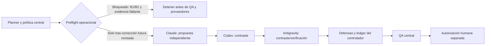

# Antigravity en IA-Ipanema — candidato aislado

Fecha: 2026-11-18  
Estado operativo: **`needs_evidence`**  
Base aislada: commit `b91a85445cb750d5f6482c936cf631919242b5c1` en `/tmp/ia-ipanema-antigravity-isolated-20261118`  
Base de repositorio operativo: `cb4bcca8b3de409ff6f40cd83e2de4de4158bfe6`

## Resultado

Se preparó un candidato local en una copia aislada. El repositorio operativo no tuvo archivos de código modificados. El diff está en `candidate.patch`; su SHA256 es `ca071456b9cc972fb6c0c43d4d63734be7a4f424e7be1d3991a3f7eeac3b0d83`.

La integración del consejo sintético Claude+Codex+Antigravity y el adaptador `agy` están implementados en el candidato. **La ejecución real permanece bloqueada por código**: el adaptador no accede a autenticación, no hay política de egreso por destino, modelo/cuenta y sobre de salida aún no fueron verificados y no está demostrado que `agy` desactive todas sus herramientas/subagentes. Cambiar `models.json` no elimina estos bloqueos.

## Archivos incluidos

Ocho módulos y catálogo:

- `tools/ipanema/orchestration/adapters.py`
- `tools/ipanema/orchestration/planner.py`
- `tools/ipanema/orchestration/engine.py`
- `tools/ipanema/orchestration/council.py`
- `tools/ipanema/orchestration/council_runtime.py`
- `tools/ipanema/orchestration/isolation.py`
- `tools/ipanema/orchestration/recovery.py`
- `tools/ipanema/orchestration/cli.py`
- `tools/ipanema/orchestration/models.json`

Cinco archivos de pruebas:

- `tests/unit/test_antigravity_integration.py` (nuevo)
- `tests/unit/test_orchestration.py`
- `tests/unit/test_council_dual.py`
- `tests/unit/test_council_engine.py`
- `tests/unit/test_council_policy.py`

Los hashes base y finales de cada archivo están en `manifest.json`.

## Qué implementa

- Identidad `antigravity` enlazada al ejecutable local `agy`; catálogo triádico Claude/Codex/Antigravity y CommandCode deshabilitado.
- Especialidades predeterminadas: Claude arquitectura/riesgos; Codex implementación/pruebas; Antigravity rendimiento/accesibilidad/UX/verificación.
- Enrutamiento que conserva revisor distinto del implementador; L4 exige dos revisores independientes cuando hay tres participantes.
- Fases de propuesta independiente, contraste y defensa reutilizan el consejo y el ledger existentes; no deciden por mayoría.
- El CLI solo se arma con flags observados en `agy --help` local: `-p`, `--model`, `--output-format json`, `--json-schema`, `--mode plan`, `--sandbox`, `--disable-slash-commands`. No se usa `--dangerously-skip-permissions` ni un flag de esfuerzo no documentado.
- El prompt se pasa a `-p`; el adaptador rechaza prompt vacío o mayor a 96.000 bytes. Este límite es de transporte/argumento de esta implementación, **no** una medición del contexto del modelo.
- El parser rechaza JSON mal formado, claves duplicadas y sobres/envoltorios de salida que no fueron observados.
- Membresía/capacidad se separan de preparación operativa. El bloqueo de ejecución incluye guardas en motor, runtime del consejo, aislamiento y recuperación, antes de QA o trabajadores.
- El runtime Antigravity no define montajes ni variables de autenticación. Se rechazan overrides locales que intenten añadir credenciales o ampliar las rutas montadas.
- Los perfiles de modelo permanecen `null`/`unverified`; no se inventaron identificadores ni acceso de cuenta.
- `doctor` hace comprobaciones locales de versión/ayuda; no prueba login ni llama a inferencia. `smoke` no admite Antigravity.

## Contrato candidato del adaptador

Invocación preparada, **no ejecutada**:

```text
agy --model <ID_VERIFICADO> --output-format json --mode plan --sandbox --disable-slash-commands --json-schema /workspace/council-response.schema.json -p <PROMPT>
```

El modelo debe existir en el catálogo verificado; hoy está `null`, así que `argv()` lo rechaza. No se verificó mediante proveedor la semántica del schema flag, la forma del JSON final, el modelo/cuenta autenticados, el contexto máximo, ni el tiempo real de cancelación. El proceso se conectaría al supervisor/aislamiento existente si se superaran los bloqueos; no se probó el comportamiento real del proveedor.

## Flujo



El camino real hoy termina en el preflight bloqueado. La secuencia completa solo está cubierta con workers sintéticos.

## Pruebas y verificaciones

Comando focalizado:

```bash
PYTHONPATH=tools python3 -m unittest \
  tests.unit.test_antigravity_integration \
  tests.unit.test_orchestration \
  tests.unit.test_council_dual \
  tests.unit.test_council_engine \
  tests.unit.test_council_policy -v
```

Resultado: **107 pruebas, OK**. Incluyen registro/enrutamiento, independencia de propuestas, contraste/defensa sintéticos, datos/evidencia inventados, restricciones de escritura, compatibilidad de política dual, bloqueo antes de QA/trabajadores, ausencia de permisos MCP, negativa a quitar B1/B2 solo mediante edición del catálogo, respuestas incompletas/error de autenticación simulado y cancelación/reaping de un proceso sintético. No se repitió la suite histórica completa. Recibo de consola: `qa-focused.log`.

También: AST válido para 13 archivos, JSON del catálogo parseable, `git diff --check` limpio. No se ejecutó QA central general porque no se integró ni se invocaron proveedores; no se ejecutaron Claude/Codex/Antigravity ni requests de red/inferencia.

Los fixtures sustituyen la preparación operativa para probar la máquina del consejo. No demuestran independencia de proveedores reales, autenticación, aislamiento del CLI, llamadas de red, cancelación real de `agy`, contexto, schema remoto ni salida real.

## Capacidades verificadas localmente

- `agy --version`: `1.5.10`.
- `agy --help`: soporte observado para modo no interactivo `-p/--print`, selector `--model`, salida `text|json|stream-json`, `--json-schema`, `--mode plan|auto|accept-edits`, `--sandbox`, `--disable-slash-commands` y `--print-timeout`.
- Salida íntegra local de esos comandos: `agy-local-help.txt`.
- No se ejecutó `agy models`/`agy agents` porque el acceso a cuenta/autenticación no estaba autorizado ni se quería provocar acceso externo. El catálogo de modelos y disponibilidad no se conocen.
- El help no prueba qué herramientas, MCP o subagentes pueden activarse en runtime. Los modos `plan` y `sandbox` no se consideran aislamiento de egreso.
- Context7 no estaba disponible en las herramientas MCP de esta sesión; se usó la ayuda del binario instalado como evidencia de sintaxis, no se afirma una verificación documental externa adicional.

## Bloqueos de seguridad

- **B1, credenciales:** el mecanismo de identidad CLI existente requiere autenticación local, pero el worker de herramientas no puede verla con seguridad en el aislamiento actual; el montaje de auth observado en el camino general es legible por procesos hijos. Esta integración no monta esa auth, por lo que no puede autenticar `agy`. No se inspeccionaron credenciales reales.
- **B2, egreso:** el aislamiento no demuestra filtrado de destinos para el camino de inferencia. `network` no se convierte aquí en una política deny-by-default por dominio/IP. No se realizó conexión real.
- **Cuenta/modelo/salida:** no hay modelo seleccionado ni forma de salida real validada; por eso los perfiles son nulos y el parser acepta solo una forma directa conservadora.
- **Herramientas/subagentes:** la CLI documenta `plan`, sandbox y desactivar slash commands, pero no se demostró la desactivación de todo acceso a herramientas o delegación.
- **Cancelación real:** el worker reutiliza supervisor/process-group existente en código, pero la terminación de un proceso `agy` real y sus descendientes no fue probada.

La autorización humana no se deriva de hashes. No se invocó ningún proveedor y no hubo coste de inferencia.

## Compatibilidad, integración y reversión

- V2 dual sigue representable y sus pruebas offline pasan; CommandCode continúa preservado en catálogo/adaptador histórico pero deshabilitado en el consejo nuevo.
- El candidato no modifica el repo operativo, política de acceso MCP ni producción. Sus hashes son candidatos locales, no autorización para instalar/integrar.
- `git apply --check candidate.patch` pasó contra un snapshot limpio del commit base aislado.
- Para una futura integración: primero resolver B1/B2 y evidencia de cuenta/modelo/salida/herramientas; luego revisión independiente del diff exacto, QA central requerido y autorización humana específica. No habilitar simplemente `provider_execution` ni editar `models.json` para saltar el bloqueo.
- Reversión futura (solo tras autorización de integración): revertir exactamente el patch aplicado; preservar cualquier cambio ajeno. El reporte y patch quedan como artefactos de auditoría.

## Estado

**IMPLEMENTADO:** adaptación local aislada del catálogo, routing, contratos del consejo, parser y gate de ejecución.  
**PROBADO:** tests sintéticos/focalizados señalados arriba.  
**BLOQUEADO:** autenticación aislada, egreso por destinos, modelo/cuenta/sobre de salida, políticas efectivas de herramientas/subagentes y cancelación real.  
**PENDIENTE DE AUTORIZACIÓN:** revisión independiente e integración; cualquier llamada real a proveedores.

Resultado global: **`needs_evidence`**. No es una integración operativa de tres agentes ni una aprobación del controlador.
