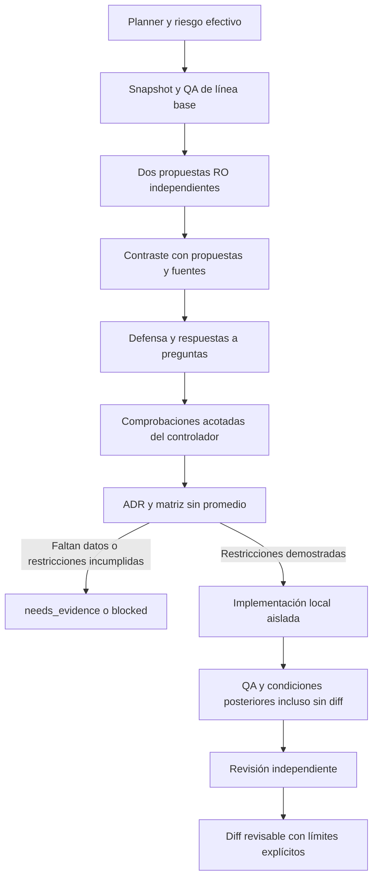

# Consejo técnico de IA-Ipanema

Extensión del mismo planner/engine, adaptadores, Supervisor, worktrees y QA. No es un segundo ejecutor ni distribuye código del tema entre tiendas. No modifica temas originales ni publica.

## Participantes y autoridad

La única fuente de participación es `tools/ipanema/orchestration/models.json`, clave `council`: modo `dual-agent`, miembros `claude` y `codex`, `commandcode` deshabilitado. Se conservan su adaptador, modelos y resultados históricos; no se invoca su CLI, no recibe nuevos grants MCP y no puede entrar por failover. `.local/orchestration.json` no puede cambiar miembros. Reactivarlo exige una autorización futura expresa y un cambio revisable del registro; no hay reactivación automática.

Claude y Codex tienen la misma autoridad técnica. El controlador prepara una sola evidencia factual y un snapshot común; las propuestas iniciales nunca incluyen la opinión del otro. Los roles de arquitectura/implementación son especialidades, no jerarquías ni votos de mayor peso.

## Uso

```bash
python3 tools/ia.py orchestrate doctor
python3 tools/ia.py --project damarbeauty orchestrate plan \
  "Auditar paginación del componente compartido" --read-only \
  --file snippets/product-list/pagination.tpl \
  --file sections/main-products-grid.tpl
python3 tools/ia.py --project damarbeauty orchestrate run /ruta/al/plan.json --execute
```

`plan` no consume inferencia. `run --execute` sí usa las cuentas nativas preparadas del propietario. No instala runtimes ni inicia login/OAuth/MCP. El modelo recibe archivos seleccionados y evidencia del controlador, sin acceso a credenciales de tienda. Las instrucciones, skills y fuentes de una deliberación quedan congeladas y fechadas. Los modelos no ejecutan herramientas: las pruebas las ejecuta el controlador y el revisor recibe sus resultados reales.

| Nivel/modo | Deliberación | Después |
|---|---|---|
| L1 auto | Un worker rápido; sin consejo | Flujo existente |
| L2 auto | Sin consejo; principal y revisión breve | Flujo existente |
| L1/L2 `--council full` | Dos análisis compactos con perfil rápido/equilibrado | Gates y QA iguales |
| L3 auto | Perfiles fuertes para deliberación y cambios compartidos | Codex por defecto; revisión independiente obligatoria |
| L4 auto | Ambos originales; revisor diferente del implementador y QA del controlador reforzado | No autoriza operaciones remotas |

Los niveles se recalculan en el engine; L3/L4 no aceptan `--council off` ni un plan adulterado que omita el consejo. La selección mantiene el registro fechado de modelos. No hay subida de esfuerzo por un fallo del entorno. El coste monetario de cambiar de proveedor no se supone equivalente ni se inventa.

El valor por defecto `--council-rounds 2` permite dos intercambios después de las propuestas independientes: preguntas/objeciones y defensa/respuestas. Son seis invocaciones de workers para dos miembros, antes de reintentos, implementación y revisión. L3/L4 requieren los dos intercambios. `--council-rounds 1` solo permite contraste compacto en niveles menores y no acredita respuestas a objeciones. El modo full se solicita explícitamente para tareas pequeñas.

Codex implementa y Claude revisa por defecto. `--implementer claude` invierte ambos roles. En L2–L4 el controlador rechaza planes sin revisión y cualquier intento de autoaprobación, también tras failover. En modo dual L4 tiene **un proveedor independiente del implementador**, además del QA objetivo del controlador: no se contabilizan dos sesiones de un proveedor como dos revisores diferentes. Si se necesita una segunda revisión humana, queda pendiente de autorización externa; el consejo no la inventa.

## Flujo y gates



La primera fase no recibe opiniones del otro participante. Ambos revisan arquitectura, viabilidad, SEO, rendimiento, responsive, accesibilidad y contratos comerciales. En contraste cada pregunta tiene ID, destinatario, alternativa y referencias. El prompt congelado conserva la identidad del participante. El schema nativo de defensa limita IDs y cantidad a las preguntas recibidas; el controlador exige el conjunto exacto de pares proveedor/pregunta al aceptar y al recuperar respuestas. En defensa se exige responder las preguntas asignadas con `question_id`, `from_agent`, evidencia y disposición (`defend`, `revise`, `withdraw` o `needs_evidence`). Pueden cambiar de preferencia o retirar sus propias alternativas. Una pregunta inventada, sin respuesta o pendiente de evidencia impide aprobar el recorrido requerido.

Se registran proveedor original/efectivo, modelo, esfuerzo, intentos, duración y contadores realmente emitidos. No se almacenan razonamientos privados, credenciales ni stderr crudo. El historial de tres participantes se conserva como evidencia histórica, no como prueba del protocolo dual actual.

Cada alternativa incluye descripción, archivos, pruebas y 13 criterios: funcionalidad, seguridad, compatibilidad, reutilización nativa, SEO, rendimiento, accesibilidad, responsive, mantenibilidad, reversibilidad, complejidad, coste de desarrollo y ejecución. Primero se aplican restricciones obligatorias; nunca se compensa una violación con un promedio. Para tema, SEO/performance/accesibilidad/responsive son obligatorios; el engine deriva requisitos relevantes y no acepta debilitarlos con una lista vacía.

La confianza y las afirmaciones de los agentes no son pruebas. La identidad de una alternativa incluye descripción, archivos y pruebas: mismo ID con soluciones diferentes produce contradicción, no una unión de scope ni préstamo de evidencia. Preferencias finales pueden cambiar después del contraste. No se elige por mayoría ni por proveedor. Una alternativa objetivamente superior y con restricciones comprobadas puede seleccionarse aunque las preferencias difieran; un empate sin evidencia comparativa suficiente requiere pruebas. Una preferencia tampoco puede superar restricciones incumplidas.

Objeciones críticas/altas necesitan resolución mediante recibos del controlador ligados a la alternativa exacta. Escribir `status: resolved` en una respuesta no las resuelve. Los recibos incluyen proyecto, run, objetivo, fuente, fingerprint de alternativa y evidencia concreta. Un hash de archivo prueba identidad/existencia, no su corrección ni que Google lo haya indexado.

## Evidencia configurable sin shell de modelos

Se puede editar el plan antes de ejecutarlo o cargar una configuración con `--council-checks archivo.json` en `plan`/`task`:

```json
{
  "before": [
    {
      "id": "existing-native-symbol",
      "kind": "file_contains",
      "file": "snippets/product-list/pagination.tpl",
      "value": "pages.next",
      "alternative": "native",
      "constraint": "native_reuse"
    }
  ],
  "after": [],
  "required_constraints": []
}
```

Este ejemplo **solo prueba presencia de un símbolo**, no alcanza para aprobar una solución completa. La alternativa debe existir sin ambigüedad en las propuestas y recibir pruebas adecuadas para todas las restricciones obligatorias. No asignar un predicado trivial a una propiedad que no demuestra.

Tipos admitidos: `file_exists`, `file_contains`, `file_not_contains`, `baseline_qa`, `qa_report`. Los archivos fuente deben estar en el alcance declarado, no se ejecutan expresiones regulares/shell sugeridas por los modelos. `baseline_qa` acredita únicamente el QA que realmente se ejecutó, no pruebas futuras de una propuesta.

`qa_report` recibe `report` relativo al repositorio y `checks` con nombres concretos. El archivo debe estar bajo la evidencia del proyecto, ser un reporte QA aprobado del mismo proyecto, tener como máximo24h y hashes coincidentes con el árbol comprobado. Una prueba del baseline no acredita un árbol modificado después. No convierte los datos de Google o de laboratorio en causalidad.

Los checks posteriores pueden declarar `test` para vincular un resultado a una prueba obligatoria concreta del ADR. `resolves` referencia objeciones verificables; el agente no crea recibos desde su respuesta. Lo no ejecutado queda pendiente en `council_validation`, aunque un QA genérico pase. Los adaptadores SEO/MCP existentes pueden aportar reportes autorizados, pero el consejo no conecta cuentas ni consulta servicios no autorizados.

## ADR y trazabilidad

Cada run guarda `council/context.json`, `proposals.json`, `objections.json` cuando existe contraste, `tasks.json`, `evidence.json`, `adr.json` y `ADR.md`. Estados:

- `approved`: restricciones comprobadas para implementación local.
- `approved_with_conditions`: restricciones obligatorias comprobadas; condiciones comparativas explícitamente no obligatorias pendientes.
- `needs_evidence`: faltan mediciones, participante independiente o resolución verificable.
- `blocked`: restricciones incumplidas u objeciones bloqueantes.

El engine vuelve a comprobar estado, condiciones, scope y binding. Implementar fuera de los archivos elegidos o cambiar las fuentes/instrucciones invalida el permiso. La etapa de arquitectura reutiliza el ADR colectivo, sin gastar otra inferencia ni privilegiar a Claude. En auditoría de solo lectura, el resultado colectivo también sustituye el audit duplicado. Después de una implementación siguen el QA y las revisiones independientes existentes.

Una aprobación del ADR no es aprobación final de storefront. `reviewable_partial_qa` sigue exigiendo render/SEO/performance/visual pertinentes y registra pruebas obligatorias pendientes. El QA puede rechazar una implementación pese al acuerdo del consejo, incluso si el implementador devuelve un diff vacío.

## Ausencias, recuperación y coste

Se reutiliza el Supervisor: timeout, inactividad configurable, reintentos acotados, cancelación compartida, circuit breaker y confirmación de salida antes de sustituir.403/429 detienen el run sin reintentos ni evasión. El reemplazo conserva el paquete de contexto y se registra con su identidad efectiva. No se duplica un participante mediante failover ni se declara deliberación completa si falta Claude o Codex. Las tareas seguras pueden usar al otro proveedor solo si preservan permisos e independencia; un nodo del consejo nunca sustituye su identidad original. CommandCode no es candidato.

Si la primera ronda no reúne participantes independientes completos, se conservan los resultados útiles y se omite un contraste que no podría aprobarse. La ausencia nunca da permiso para modificar una tienda. En L3/L4 la falta de revisión independiente posterior bloquea su aprobación.

Opciones locales en `.local/orchestration.json`: `timeout_seconds`, `idle_timeout_seconds`, `recovery` existentes, `time_limits` por proveedor y `council_max_calls` (1–12, default seis en dual). El último limita **intentos de workers**, incluidos reintentos; no garantiza un número exacto de llamadas API internas de cada CLI ni un presupuesto monetario. El ADR registra el consumo observado. No hay ampliación silenciosa tras agotar el presupuesto.

## Validación y límites

```bash
python3 tools/ia.py qa --suite orchestration
python3 tools/ia.py qa --suite quick
python3 -m unittest tests.unit.test_council_policy tests.unit.test_council_engine tests.unit.test_council_receipts tests.integration.test_council_cli -q
```

Fixtures validan gates, desacuerdos, datos maliciosos, ausencias, permisos y rechazo por QA; están etiquetados como simulaciones de proveedor. Git, CLI y sandbox usados por los tests correspondientes son reales. Esto no demuestra que ambas cuentas reales estén disponibles ni que las decisiones de sus modelos sean siempre correctas. Las comprobaciones reales y sus fallos se registran en [el informe de verificación](council-verification.md). La estabilización histórica de tres participantes completó seis nodos sobre paginación. La autenticación se recuperó y se completaron dos deliberaciones duales reales de lectura; sus ADR siguen `needs_evidence`. Consulta el informe actual, sin trasladar el éxito histórico ni la deliberación a una aprobación de cambios.

Fuentes de modelos conservadas de la verificación histórica del 10-11-2026 UTC (no reconsultadas para este cambio): [OpenAI Models](https://learn.chatgpt.com/docs/models), [configuración Codex](https://learn.chatgpt.com/docs/config-file/config-reference), [Claude Code](https://code.claude.com/docs/en/model-config), [CommandCode](https://commandcode.ai/docs/reference/cli/models). Se corrigió el ID exacto del perfil fuerte de CommandCode a `moonshotai/Kimi-K3.1-Pro`. Disponibilidad de catálogo no equivale a acceso de una cuenta.

## Protocolo estabilizado y recuperación

El [informe vigente](council-verification.md) y [la evidencia estructurada](council-stabilization.json) distinguen deliberación completa, acuerdo y autorización. Un consejo con ambos contrastes y defensas válidos puede decidir `needs_evidence`: eso no es un proveedor ausente ni permiso de edición. `coverage.deliberation_complete` y `coverage.agreement` separan esas situaciones; el campo antiguo `consensus` se conserva por compatibilidad.

La propuesta incluye análisis compacto, hasta3 alternativas con la matriz existente, referencias, impactos, pruebas y confianza. El contraste incluye preferencia, hasta8 objeciones y preguntas al otro participante; la defensa incluye respuestas verificables y revisiones. El ID de alternativa se limita a letras minúsculas, dígitos y guiones, hasta51 caracteres; se comprueba en schema nativo y local. El normalizador conserva `evidence`. Los schemas se generan desde el contrato existente mediante `council.response_schema`, se aplican en la CLI cuando existe soporte nativo y se verifican localmente. No se instalaron dependencias.

Codex utiliza `--output-schema`; Claude `--json-schema`, `stream-json` y mensajes parciales. El parser NDJSON de CommandCode queda preservado para historial y una eventual reactivación autorizada; no se utiliza en ejecuciones actuales. La primera ronda no contiene pares, discovery completo ni registros irrelevantes. En fuentes extensas, `source_windows` del plan declara rangos inclusivos de líneas; el prompt conserva hash completo, rangos y aviso de extracto. Todos reciben el mismo snapshot y ventanas. No se omite texto silenciosamente.

Límites predeterminados del worker:

| Perfil | Duración máxima | Inicio/entrega de contexto | Primera salida CLI Claude/Codex/CommandCode | Inactividad posterior |
|---|---:|---:|---|---:|
| fast |120s |30s |120/150/180s |90s |
| balanced |240s |30s |120/150/180s |90s |
| strong |360s |30s |240/300/360s |90s |
| critical |600s |30s |240/300/360s |90s |

Se aplica el primer límite alcanzado; el máximo puede vencer antes que la primera salida. `time_limits` permite configurar `startup`, `first_response`, `idle` y `total` por proveedor. Los límites antiguos `timeout_seconds`/`idle_timeout_seconds` siguen prevaleciendo para compatibilidad. La primera salida es un evento del CLI, **no necesariamente el primer token del modelo**. La espera interna de servidor/red/inferencia no se separa sin datos del proveedor. Las herramientas de tienda permanecen deshabilitadas; la serialización nativa no equivale a una acción sobre el tema.

En la integración histórica deshabilitada, CommandCode se consume línea a línea: los snapshots de progreso no agotan el presupuesto de la respuesta final. Se conservan errores, resultados y señales de herramientas, además de contadores de eventos/bytes. Hay límites máximos de bytes retenidos y de transporte; no se permite salida indefinida.

Una respuesta inválida produce categoría y ruta de campo del validador, sin guardar el valor rechazado ni salida privada. Un fallo histórico sin esa instrumentación se declara no determinado. Un reintento de contrato puede hacer **una nueva inferencia del mismo proveedor**, solo después de acreditar salida del proceso y dentro del presupuesto compartido; no rellena valores ni convierte respuestas inválidas en aprobadas. El consejo no sustituye proveedores originales mediante failover.

Cada nodo terminado guarda su envelope/checkpoint inmediatamente. La API existente `engine.run_council` puede reanudar un run RO con el mismo plan, snapshot e instrucciones: revalida binding y contratos, exige procesos anteriores recogidos, conserva el presupuesto y reutiliza propuestas/contrastes válidos. No reanuda escritores ni amplía límites automáticamente. Deben comprobarse también los hashes originales, como hace el controlador de la ejecución documentada. No se creó un segundo orquestador.

Fuentes de interfaz verificadas: [Codex no interactivo](https://learn.chatgpt.com/docs/non-interactive-mode), [Claude CLI](https://code.claude.com/docs/en/cli-reference), [CommandCode headless y NDJSON](https://commandcode.ai/docs/headless), además del `--help` de las tres versiones instaladas. No existe garantía de compatibilidad con otras versiones sin revalidarlas.
