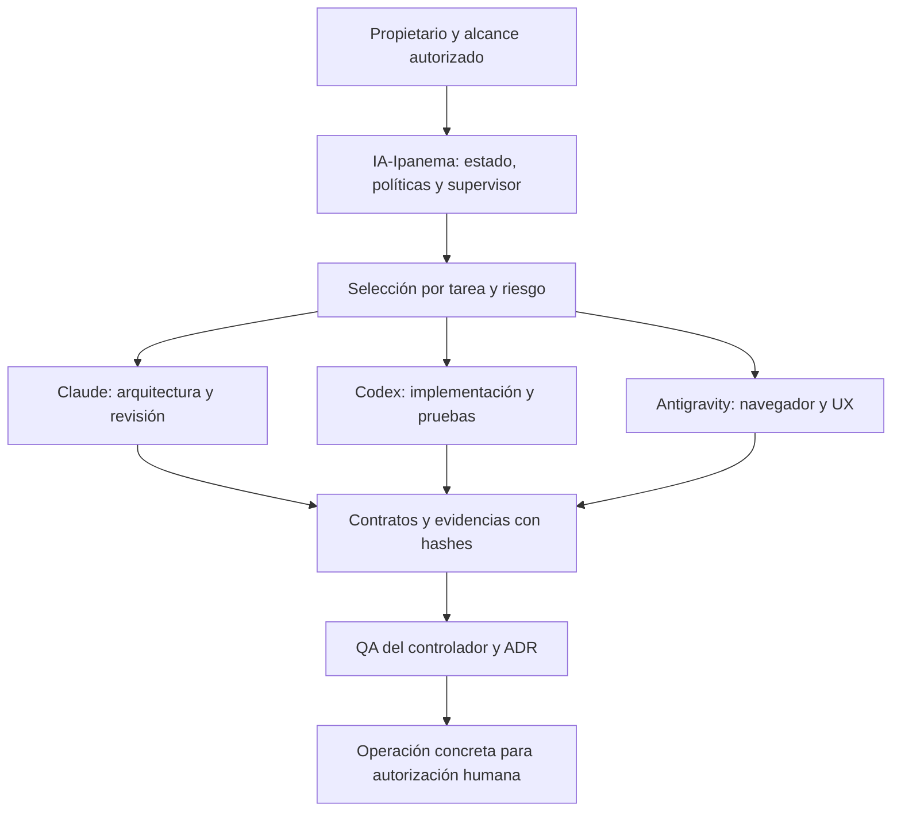

# IA-Ipanema V3 — discovery de tres agentes

Fecha: **17 de noviembre de 2026**. Estado: **propuesta de arquitectura; `needs_evidence` para integración y ejecución real**.

Esta entrega documenta capacidades, límites y migración. No implementa V3, no cambia la política dual, no instala proveedores y no abre Rhino Performance. Cero llamadas de inferencia, cero sesiones de navegador y cero despliegues en este discovery. La propuesta no es una aprobación del consejo.

## 1. Dictamen y alcance comprobado

**La integración es viable para prototipar mediante la CLI oficial `agy` ya instalada. No está demostrada todavía como integración segura de IA-Ipanema.** Existen también ACP y un SDK oficial, pero no hace falta sustituir el orquestador ni instalar el SDK para la primera prueba.

La recomendación es extender gradualmente los adaptadores, contratos y supervisor actuales. Los tres agentes aportan especialidades, mientras IA-Ipanema conserva tareas, límites, evidencias, QA y decisión operacional. La autorización humana sigue siendo necesaria para producción. Ningún resultado `approve` concede permisos.

La documentación describe las capacidades del producto. La ayuda local acredita flags de esta instalación. Ninguna de esas dos fuentes acredita por sí sola una cuenta autenticada, una sesión headless satisfactoria o el funcionamiento del navegador bajo nuestro aislamiento.

### Evidencia local

| Elemento | Observación | Límite |
|---|---|---|
| Antigravity CLI | `/home/alanrichard/.local/bin/agy`, **1.5.10**, binario ELF | Autenticación e inferencia no comprobadas |
| Launcher IDE | `/usr/bin/antigravity`, **1.107.0**, build15487b3041e65228cae24980a3f796c905ef582c | Es la versión del launcher/paquete observado; no demuestra Antigravity App2.30 ni sus funciones |
| Claude Code | **2.1.326** | Ayuda de agentes disponible; delegación aislada no ejecutada |
| Codex | **0.169.0** | `exec` y sandbox documentados en ayuda; delegación de esta CLI no probada |
| Node/npm | **24.22.0 / 11.19.1**, evidencia de preparación Context7 del mismo día | Sin instalaciones nuevas |
| Chrome | **155.0.8059.84** | Supera el requisito documental del browser CLI; sin conexión ni debugging activado por nosotros |
| SDK Python Antigravity | No figura entre distribuciones del intérprete actual | No equivale a ausencia en todos los entornos virtuales |
| `gemini` CLI | No está en PATH | No se necesita como sustituto de `agy` |
| `agy agents` | exit0, salida vacía | No acredita ni descarta subagentes integrados o delegación funcional |
| `agy mcp list` | exit0; Context7 no aparece | No se creó configuración MCP de Antigravity |
| Context7 del controlador | No expone `resolve-library-id`/`query-docs` en esta sesión | Se usaron fuentes oficiales como fallback; no se afirma autenticación nueva |

Se inspeccionaron únicamente claves no secretas de settings: `~/.gemini/antigravity-cli/settings.json` contiene preferencias visuales y workspaces confiables, sin política explícita de permisos observada. El archivo `~/.gemini/config/mcp_config.json` existe con **0 bytes** y no es JSON válido. No se corrigió: `agy mcp list` no falló; no hay evidencia suficiente para atribuirle un defecto funcional o afirmar que la CLI lo consuma obligatoriamente.

Ayudas conservadas: [agy](agy-help.txt), [ACP](agy-acp-help.txt), [Claude agents](claude-agents-help.txt), [Codex exec](codex-exec-help.txt). [Observaciones estructuradas](observations.json). No se inspeccionó ni copió el contenido del keyring o de credenciales.

## 2. Interfaces oficiales y elección

### CLI headless: opción preferida para el piloto de integración

`agy --help` confirma `-p`/`--print`, `--output-format` text/json/stream-json, `--json-schema`, `--conversation`, `--continue`, `--print-timeout`, `--settings`, `--mode`, `--sandbox` y `--disable-slash-commands`. No hay que inventar un endpoint privado. Se propone comenzar con una sola tarea sintética y contrato cerrado, sin herramientas ni red de cliente.

La documentación distingue respuesta en stdout y diagnósticos en stderr; el JSON incluye conversación, estado y uso, y NDJSON permite seguir eventos. También advierte que una acción denegada puede no convertir la salida del proceso en error: **exit0 no demuestra que se ejecutó el QA solicitado**. Deben comprobarse el resultado estructurado y los recibos de herramientas. [Headless oficial](https://antigravity.google/docs/cli/headless/).

No se adjunta un comando «listo para ejecutar»: falta fijar modelo disponible, política efectiva, montaje de autenticación, formato de eventos y aislamiento. Los flags observados son capacidades, no una invocación segura ya aprobada. No se usará `--dangerously-skip-permissions`, `--remote-agent`, remote-control ni instalación automática.

### ACP: alternativa para interacción persistente

`agy acp --help` existe localmente. La interfaz oficial conecta un proceso mediante JSON-RPC sobre stdin/stdout y reutiliza el entorno de autenticación/configuración de Antigravity. Puede ser útil si se necesitan permisos interactivos y sesiones persistentes; requiere comprobar la versión y capacidades negociadas, además de implementar un cliente ACP. **MCP y ACP son protocolos distintos.** No se arrancó el servidor. [ACP oficial](https://antigravity.google/docs/cli/acp/).

### SDK Python: alternativa posterior

Google documenta `google-antigravity` y `Agent`/`LocalAgentConfig` para construir agentes con herramientas, políticas, estado y delegación. Existen rutas de autenticación y facturación distintas según proveedor. No se presupone que una suscripción local habilite automáticamente cualquier ruta SDK/API. Esta opción añade dependencias y otra superficie de integración; queda pospuesta hasta demostrar una carencia concreta de la CLI. No se instaló ni se solicitó una clave. [SDK oficial](https://antigravity.google/docs/sdk/overview/).

### Autenticación: condición abierta importante

La guía describe reutilización local de sesión mediante el keyring y autenticación interactiva cuando falta. Eso **no prueba el estado de esta cuenta**. No se lanzó `agy` interactivo, no se inició OAuth ni una consulta al modelo. En particular, el aislamiento V2 no debe montar todo el keyring, HOME o bus de sesión para que un proveedor funcione. Hay que validar un mecanismo oficial de autenticación compatible y acotado. Si no existe dentro de la frontera actual, el adaptador queda bloqueado. [Autenticación oficial](https://antigravity.google/docs/install/).

Alternativa soportada si el aislamiento programático no se resuelve: el propietario usa la CLI/App oficial y proporciona los artefactos de una tarea acotada. Se incorporan como evidencia externa, con su procedencia y limitaciones; no se simula un worker integrado ni se concede una aprobación independiente automáticamente.

## 3. Navegador, UX y mediciones

La documentación ofrece `/browser` con Chrome DevTools, capturas, inspección de consola/red, trazas, Lighthouse, emulación y evaluación de scripts. En CLI requiere Chrome144+ y conexión explícita a Chrome con depuración remota. La disponibilidad del navegador integrado de App depende de versión y cuenta; no se extrapola al launcher local. [Browser use](https://antigravity.google/docs/browser/) y [comando browser](https://antigravity.google/docs/commands/browser).

Antigravity puede ser **Browser, UX & Verification Lead**, pero disponer de Chrome o de una descripción comercial no prueba que nuestras políticas de GET, orígenes, exclusión de compras, presupuestos y cancelación alcancen sus herramientas nativas. Esa será una condición de aceptación, no un permiso inferido.

Diseño propuesto: IA-Ipanema concede una reserva exclusiva de navegador a una tarea, con perfil de QA dedicado, sin sesiones administrativas ni credenciales de compra. Si la conexión oficial solo puede controlar un Chrome personal o no permite limitar sus capacidades, **no se habilita navegación de producción**. Primero se prueba una fixture local, después un origen público específicamente autorizado. Una fixture local no sustituye la validación final de Rhino publicado; no se crean tiendas clonadas ni staging.

Lighthouse, Network y traces deben producir archivos originales con perfiles, fechas y hashes. Un screenshot o el texto «todo correcto» no prueba score, ausencia de errores ni bloqueo efectivo de escrituras. No se ejecutarán mediciones en paralelo, tampoco durante pruebas de CPU intensivas de otros workers.

## 4. Capacidades de subagentes, sin equiparar interfaces

| Cliente | Capacidad documentada/local | Situación en IA-Ipanema |
|---|---|---|
| Claude | Agentes personalizados, herramientas restringibles y modos heredados; `--agents` y administración de agentes en ayuda | El adaptador V2 utiliza `--tools ''`, modo restringido y MCP vacío. No permite asumir que delegará |
| Codex | Subagentes y definiciones TOML; sandbox/permisos heredados de la sesión principal | Configuración local sin sección explícita de agentes: no demuestra que estén deshabilitados por defecto. No se lanzó un hijo de esta CLI |
| Antigravity | Documenta subagentes, herramientas de delegación, identificadores y panel `/agents`; CLI local permite seleccionar/listar agentes | La lista local está vacía; no se verificaron creación, comunicación, cancelación ni eventos de hijos |

Claude admite restricciones por herramienta y sus modos no deben confundirse con una frontera OS. La herencia depende del modo principal; una definición de agente no garantiza por sí sola reducción de privilegios. [Claude: subagentes](https://code.claude.com/docs/en/sub-agents).

Codex documenta que los hijos heredan sandbox, permisos y MCP del padre. Sus definiciones pueden reducir ciertas herramientas, pero no reemplazar el sandbox del padre. Debe validarse la versión de la CLI y el contrato real de eventos; no se transplantan campos de Responses API o Agents API como si fueran flags del ejecutable. [Codex: subagentes](https://learn.chatgpt.com/docs/agent-configuration/subagents).

Antigravity documenta agentes personalizados y permisos/herramientas asignados por el principal. Las herramientas internas de delegación no son endpoints públicos universales para llamar desde Python. Tampoco se presupone que estados, campos o límites de anidamiento de App, CLI y SDK coincidan. [Antigravity: subagentes](https://antigravity.google/docs/subagents?tab=cli).

### Registro propuesto por hijo

Cada hijo requiere: `child_id` central, `native_child_id` cuando exista, `parent_task_id`, `responsible_agent`, identidad efectiva de proveedor/modelo, objetivo, alcance de archivos/orígenes/métodos, referencia a autorización, permisos efectivos, presupuesto reservado, hashes de entrada, referencias a evidencias, estado y resultado validado.

Si el runtime no permite observar y limitar hijos, **delegación deshabilitada para ese adaptador**. No se inventan IDs ni se reconstruye una lista confiable solo desde un relato del padre. IA-Ipanema puede ejecutar subtareas centrales separadas con el adaptador disponible; debe etiquetarlas como tales, sin llamarlas subagentes nativos.

Propuesta inicial conservadora: un nivel de hijos y hasta dos hijos activos globales, siempre dentro del límite de procesos total; más profundidad requiere nueva evidencia y aprobación de política. Cada hijo consume el presupuesto reservado del padre. La relación obligatoria es `permisos_hijo ⊆ permisos_padre ⊆ autorización_propietario`, comprobada también por aislamiento y herramientas, no solo por prompts.

Un hijo de Claude no sustituye una revisión independiente de Codex o Antigravity. La independencia se calcula por proveedor efectivo y por participación real en el cambio, no por cantidad de sesiones.

## 5. Arquitectura propuesta: evolución del motor actual



Se reutilizan registry de modelos, DAG, supervisor, snapshots privados de ingeniería, locks, contratos, recibos y ADR. Los snapshots de código no son clones de tiendas ni destinos de despliegue. El orquestador no se convierte en un publicador autónomo.

Cambios futuros que requieren un diff y autorización separados:

| Componente actual | Condición localizada | Evolución mínima a evaluar |
|---|---|---|
| `models.json:council` | Solo Claude/Codex habilitados; CommandCode deshabilitado | Registrar Antigravity con capacidades verificadas, sin reactivar CommandCode |
| `adapters.py` | `NAMES` cerrado y validación del universo de participantes | Adaptador `antigravity`, parser nativo, política única de participantes |
| `planner.py` | Implementador/revisor y routing incluyen supuestos duales | Selección por especialidad, capabilities y riesgo, sin cambiar mínimos de revisión silenciosamente |
| `council.py` / `council_runtime.py` | Contratos, referencias y agregación existentes | Admitir participantes requeridos por tarea, sin perder preguntas, defensas ni recibos |
| `engine.py` | Lista cerrada de runtimes; manejo específico de auth y modelos | Integración declarativa del proveedor y conservación de identidad efectiva |
| `isolation.py` / `recovery.py` | Workers con herramientas restringidas y cancelación de procesos | Validar nueva CLI, hijos y recursos de navegador sin ampliar montajes o egress por conveniencia |

No basta cambiar `members` a tres valores: actualmente el validador exige que habilitados+deshabilitados coincidan con `NAMES`, que no incluye Antigravity. El motor rechaza IDs desconocidos y el planificador solo admite Claude/Codex como implementadores. Esta protección no se desactiva durante el discovery.

El QA del controlador ejecuta/verifica herramientas y artefactos. Antigravity propone el plan de verificación y puede operar un browser autorizado, pero no se convierte en autoridad para declarar su propio gate aprobado.

## 6. Selección y consumo proporcional

| Tarea | Especialista inicial propuesto | Revisión y QA |
|---|---|---|
| Error simple de implementación | Codex | QA proporcional; revisión adicional según riesgo vigente |
| Arquitectura/causa raíz | Claude | Codex verifica contratos o reproducibilidad cuando corresponda |
| Responsive/UX | Antigravity, solo tras habilitar capacidades | Revisor distinto del implementador y evidencia visual |
| Lighthouse complejo | Los tres, en etapas | Una sola medición central compartida; análisis independientes de los mismos originales |
| Cambio crítico de producción | Los tres si son pertinentes y requeridos por el plan | Objeciones críticas resueltas, dos revisores distintos del implementador cuando se exija y autorización humana exacta |

La tabla es **propuesta**, no modifica L1–L4 vigentes. Bajo V2, un error responsive no autoriza despachar un worker Antigravity desconocido ni omitir el consejo obligatorio. La migración debe aprobar expresamente la nueva selección sin debilitar los mínimos de seguridad.

Los roles son preferencias, no exclusiones. Si Antigravity implementa, Claude y Codex pueden revisar; si un proveedor carece de una capacidad exigida, no se inventa su aportación. Una ausencia en una tarea de tres participantes obligatorios conserva `needs_evidence`; una reducción del conjunto requiere replanificar y justificarla, nunca simular una firma.

### Estimación de recursos y presupuestos iniciales

Equipo observado: **8 CPU lógicas, aproximadamente7.53GiB RAM total y2.94GiB disponibles** en ese instante. No se midió RSS de ejecuciones reales ni consumo de inferencia Antigravity. No hay base para prometer coste en dólares, velocidad o ahorro porcentual.

Estimación administrativa reproducible: un consejo de tres con propuestas, contraste y defensa agrupados por participante necesita **hasta9 intervenciones principales** antes de implementación; una implementación y dos revisiones finales llevan el escenario completo a12, sin contar hijos o recuperación. El consejo dual equivalente necesita6+1+1=8. No se lanza ese escenario para toda tarea. Analizar dos propuestas ajenas en una respuesta evita convertir seis relaciones cruzadas en seis procesos adicionales.

Fórmula de consumo: suma de entrada/salida/contexto de cada llamada + herramientas + hijos. Contabilizar caché y coste solo si el proveedor los informa; créditos o suscripción no equivalen a coste marginal cero. Reservar presupuesto del padre antes de iniciar cada hijo, con tope global de tiempo/tokens/salida y parada ante cuota,403/429 o agotamiento. No hay un límite de tokens portable demostrado entre las tres CLI: el controlador debe suplir la cancelación y declarar consumos desconocidos cuando falten contadores.

Como **reserva de planificación, no medición**, considerar0.5–1GiB por cliente activo y1–2GiB para Chrome: tres principales más navegador pueden demandar2.5–5GiB adicionales. Con la memoria disponible observada no se recomienda activarlos todos a la vez. Iniciar pilotos con un worker durante navegador/performance y máximo dos procesos de inferencia fuera de mediciones; ajustar estos límites tras medir RSS, procesos hijos y tiempos. Las propuestas pueden ejecutarse secuencialmente conservando independencia al no revelar pares antes de terminar las tres.

## 7. Protocolo de comunicación y trazabilidad

Se propone un sobre **interno de IA-Ipanema**, versionado; no es una API nativa supuesta de los proveedores:

```json
{
  "protocol_version": "ipanema-v3-proposed-1",
  "run_id": "controller-assigned",
  "task_id": "controller-assigned",
  "parent_task_id": null,
  "assigned_agent": "antigravity",
  "effective_agent": "antigravity",
  "native_session_id": null,
  "objective": "Verificar una fixture autorizada",
  "scope_ref": "controller-owned-immutable-scope",
  "authorization_ref": "owner-permission-or-local-scope",
  "input_hashes": {},
  "budget_ref": "controller-owned-budget",
  "evidence_refs": [],
  "state": "planned",
  "result": null
}
```

Los agentes no pueden editar `scope_ref`, permisos o presupuestos efectivos. El adaptador traduce salida nativa a este sobre; rechaza campos, archivos, métodos o referencias fuera del contrato. Los recibos del controlador y los resultados del modelo se almacenan por separado. No guardar razonamiento privado, tokens o stdout crudo indiscriminado: retener artefactos técnicos y métricas sanitizadas.

Estado propuesto: `planned → running → result_received → qa_pending → reviewed`; salidas `blocked`, `needs_evidence`, `failed` y `cancelled`, con evidencia de cancelación. `approve` es una opinión de revisión, nunca transición automática a publicado. Cada efecto externo tiene su propia operación/autorización y clave de ejecución única.

Eventos internos propuestos: inicio, actividad, petición de hijo, recibo de herramienta, artefacto, objeción, respuesta, final y cancelación confirmada. No se asume que todos aparezcan en el stream nativo; si no existe un evento fiable se deja el campo desconocido y se bloquea la capacidad que depende de él. Nunca convertir un JSON bien formado en prueba de un Lighthouse ejecutado.

## 8. Permisos y prevención de conflictos

Las políticas oficiales Deny/Ask/Allow y el sandbox de Antigravity son controles complementarios. No reemplazan la autorización central ni garantizan por sí solos el control de navegador/MCP. No usar modos de autoaprobación o bypass para evitar un bloqueo. [Permisos oficiales](https://antigravity.google/docs/permissions/).

- **Archivos:** un solo escritor central aplica parches propuestos después de comprobar preimágenes y manifiesto. Locks por proyecto y por archivos; los lectores reciben la misma versión inmutable. Symlinks o cambios posteriores ajenos bloquean aplicación/reversión.
- **Navegador:** una reserva central por sesión/perfil y una reserva global para benchmarking. No compartir una sesión entre agentes concurrentes ni usar un perfil personal con permisos adicionales. Confirmar liberación antes de reasignar.
- **Red:** denegar por defecto fuera de orígenes/métodos/presupuesto de la tarea. GET no basta para autorizar acciones comerciales; excluir rutas y efectos. Mantener límites y parada ante403/429 sin evasión o failover de cuota.
- **Secretos:** cada proveedor recibe solo su acceso de inferencia aprobado; nunca cookies de tienda o credenciales de otro proveedor. No montar configuraciones completas para habilitar subagentes o MCP.
- **Duplicación:** identidad de evidencia por URL/perfil/versión/fecha, manifiesto y hash; compartir originales técnicos, no repetir navegación para que cada agente «tenga su propia medición». Independencia de interpretación no requiere duplicar descargas.
- **Cancelación:** comprobar proceso padre, descendientes y herramientas externas. `process_reaped` del padre no acredita que terminó un browser remoto o un hijo persistente. Ante estado incierto, bloquear reasignación y conservar checkpoint; no iniciar otra medición encima.
- **Independencia:** revisores reciben el diff exacto y evidencia; registrar quién implementó realmente. No contar hijos del mismo proveedor como revisiones originales adicionales.

Rhino sigue sin clones, staging, escrituras, cambios comerciales o despliegues automáticos. Los permisos de lectura históricos ya consumidos no se reutilizan para nuevos experimentos V3.

## 9. Context7 sin ampliar el sandbox

Context7 está configurado globalmente para Claude/Codex según el informe del mismo día; falta la verificación autenticada de herramientas en cada cliente. No aparece configurado en la lista MCP observada de Antigravity y no se instaló allí durante esta tarea.

Los workers actuales **no heredan automáticamente esos MCP**: Claude usa configuración MCP vacía y Codex ignora configuración de usuario. Por eso instalar Context7 globalmente no demuestra que lo consulten dentro del consejo.

Propuesta inicial: el controlador recupera documentación oficial compatible con la versión local y adjunta referencias fechadas a los paquetes de evidencia. Una habilitación directa de Context7 para un worker requerirá allowlist por herramienta/servidor, autenticación propia validada y pruebas de egress; no habilitar todos los MCP ni compartir tokens. Si no está disponible, se conserva el fallback oficial documentado y se bloquea solo la decisión sin evidencia suficiente, no toda tarea.

No se ejecutó `ctx7 setup --antigravity`: sería otra configuración, fuera de este discovery. Tampoco se reutilizó un conector de cuenta como prueba de un MCP del cliente.

## 10. Migración propuesta y pruebas de aceptación

| Etapa | Operación propuesta | Criterio de salida | Estado |
|---|---|---|---|
| 0 | Este discovery y revisión humana | Separar soporte oficial, presencia local y funcionamiento probado | Documento preparado; no aprobado para integrar |
| 1 | Piloto sintético del transporte agy, fuera de clientes | Auth compatible con aislamiento, JSON/schema, sin hooks/MCP/efectos no autorizados | Requiere alcance y autorización propios |
| 2 | Diff mínimo del adaptador/registro/parser | Revisión independiente y suites existentes sin regresiones | No preparado ni autorizado aún |
| 3 | Consejo de tres solo lectura sobre fixture | Propuestas independientes, objeciones, defensas, recibos y ADR auténticos | Pendiente |
| 4 | Trazabilidad de hijos, uno por proveedor | Permisos heredados/acotados, IDs y cancelación comprobados | Pendiente; delegación deshabilitada hasta entonces |
| 5 | Browser sobre fixture local | Orígenes/métodos controlados, reserva exclusiva y artefactos reales | Pendiente; sin navegador abierto |
| 6 | QA sobre Rhino publicado | Operación remota exacta aprobada; sin escritura comercial | No autorizado por este documento |

Reutilizar las suites `test_orchestration*` y `test_council*`, ampliando las existentes cuando se implemente. No reescribir el motor ni repetir ahora sus pruebas sin cambios de código.

Pruebas necesarias antes de habilitar V3:

1. **Transporte:** entrada completa, stdout/stderr separados, JSON estricto, esquema, NDJSON truncado, salida grande, IDs de sesión y estado terminal. Fixture con herramienta soft-denied que no pueda contarse como QA pasado.
2. **Auth y aislamiento:** sin credencial, credencial no accesible, sesión válida dentro del sandbox y cierre seguro; cero secretos en logs; no montajes amplios/keyring completo ni refresh improvisado. Modelo fijado y disponible sin sustitución silenciosa.
3. **Permisos:** prohibir escritura fuera del manifiesto, rutas privadas, symlinks, red no autorizada, métodos prohibidos, MCP y plugins no declarados; intentar ampliación desde hijo y comprobar denegación efectiva.
4. **Hijos:** creación nativa real, relación padre/hijo, herramientas asignadas, presupuesto compartido, IDs/eventos, retorno, estados, profundidad y concurrencia. Comparar APIs distintas sin simular equivalencias.
5. **Supervisor:** timeout absoluto, inactividad, agotamiento, pérdida de conexión, hijo persistente, cancelación de browser y reap; no segunda ejecución ante resultado incierto,403/429 o cuota.
6. **Consejo:** tres identidades originales, propuestas sin pares, preguntas/respuestas ligadas a fuentes, revisor distinto del implementador y recibos del controlador para resolver objeciones. Probar que falta de evidencia y proveedor ausente mantienen el bloqueo.
7. **Conflictos:** dos tareas sobre el mismo archivo, cambios ajenos tras baseline, dos tareas pidiendo el mismo navegador, caída manteniendo lock y prevención de mediciones duplicadas.
8. **Browser:** seis anchos, teclado/foco/ARIA, consola/Network, trazas y Lighthouse reales, perfiles exportables y requests contabilizadas; cero formularios, compras o escrituras. No sustituir el chequeo por texto del agente.
9. **Regresión V2:** Claude/Codex siguen funcionando sin Antigravity; CommandCode continúa deshabilitado; contratos antiguos y ADR históricos conservados; configuración global no sobrescrita.
10. **Consumo:** comparar tarea equivalente de1,2 y3 participantes, contando hijos y QA. Registrar duración, RSS, uso real de proveedor y calidad. No prometer ahorro antes de medir.

La primera adaptación debe tener respaldo, pre/posthashes, manifiesto y reversión limitada. La integración de la herramienta no equivale a autorización para ejecutar producción. Volver a V2 debe detener tareas V3, comprobar recursos liberados y restaurar solo archivos propios sin cambios ajenos; no borrar checkpoints ni ADR.

## 11. Decisiones y condiciones pendientes

**Recomendado ahora:** aceptar el enfoque de extensión incremental por CLI; mantener V2 activo. Preparar después un alcance de piloto sintético que pruebe transporte, autenticación acotada y denegación de herramientas antes de modificar el motor.

**No demostrado todavía:** sesión agy autenticada, contrato real de subagentes en la instalación, restricción completa de sus herramientas, cancelación del árbol y del Chrome externo, compatibilidad de autenticación con Bubblewrap, consumo de recursos real y Context7 operativo en workers.

No hay un consejo de tres completado ni firmas independientes para esta propuesta: no se ejecutaron proveedores. `implementation_allowed:false`. Cambiar registro/modelos, políticas, adaptadores, instalar SDK/MCP o abrir un navegador conectado requerirá el alcance correspondiente. Ninguna acción futura sobre Rhino se incluye implícitamente.

### Comprobación de conservación

[Hashes de fuentes/configuraciones protegidas](protected-hashes.json) y [verificación final](verification.json). Los archivos operativos, modelos, AGENTS.md y configuraciones globales inspeccionadas permanecen íntegros. Solo se añadieron este documento y sus evidencias de discovery. No se reclamó un QA de ejecución no realizado.
