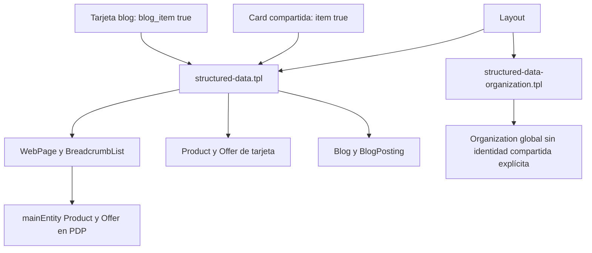

# Auditoría actual de la tienda y fuentes nativas

Fecha: 2026-11-08 UTC. Acceso storefront de lectura previamente autorizado. No se editaron temas, catálogo, políticas, cuentas ni configuración remota. Se usó el runtime V2 con protección de red, sesión efímera no guardada y capturas antes de instrumentación.

[Resumen reproducible](evidence/live-audit-summary.json) · [404 real](evidence/live-404-audit.json) · [fuente actual y consumidores](evidence/source-audit.json) · [diff propuesto](evidence/breadcrumb-proposal.json). Los JSON registran fecha, hashes, ruta local de captura, perfiles y límites. Capturas/proyecciones completas permanecen en runs locales ignorados; no se distribuye el tema propietario en este informe.

## Cobertura ejecutada

Cinco tipos de página × seis anchos (360, 390, 768, 1024, 1440 y 1920), más una captura sin JS y una reduced motion por tipo: **40 capturas**. Una 404 adicional a 390 px confirma el defecto histórico: **41 capturas vivas**, seis tipos de página. Sin JS/reduced motion se comprobaron a 360 px en los cinco tipos principales; no se extrapolan a todos los anchos. Se generaron treinta auditorías inicial/DOM a partir de los perfiles renderizados y un informe específico de 404.

| Página real | HTTP | Datos estructurados observados | Hallazgo/alcance |
|---|---|---|---|
| [Home](https://rhinoipanema.mitiendanube.com/) | 200 | Organization, WebPage/BreadcrumbList, Product/Offer y entidades anidadas de tarjetas | Un H1; diez Product de tarjetas en muestra 390; hay repeticiones exactas. No son diez PDP ni prueba de merchant listings |
| [Categoría](https://rhinoipanema.mitiendanube.com/productos/) | 200 | Organization, WebPage/BreadcrumbList y doce Product/Offer de listado en 390 | Carga adicional mediante anchor sin href. No se demuestra cobertura completa del catálogo |
| [PDP](https://rhinoipanema.mitiendanube.com/productos/botas-presoterapia-inalambricas-pro-air/) | 200 | Product/Offer dentro de WebPage, Organization y BreadcrumbList | H1 nativo más otro H1 dentro de descripción `.user-content`; precio/stock sin exportación independiente no se certifican |
| [Blog](https://rhinoipanema.mitiendanube.com/blog/) | 200 | Blog y BlogPosting en lista/tarjetas, Organization, imágenes/páginas relacionadas | Autor de artículos como texto y declaraciones repetidas de los mismos artículos. BlogPosting no requiere otro Article paralelo |
| [Artículo](https://rhinoipanema.mitiendanube.com/blog/posts/lo-que-separa-a-los-pros-no-es-el-talento-es-la-recuperacin-7cc2ca9b1e3b) | 200 | BlogPosting, Organization, ImageObject y WebPage relacionada | Autor textual; no se observó BreadcrumbList en esta rama. Canonical agrega slash: revisar normalización/redirección antes de llamar duplicación |
| URL 404 de comprobación, registrada en evidencia | 404 | Organization y script structured-data.page inválido | Error de coma final en BreadcrumbList vacío confirmado nuevamente en navegador |

En estas cinco páginas, los conjuntos observados de enlaces y JSON-LD iniciales/renderizados no cambiaron por JS durante la ventana de captura. Eso no demuestra que slides posteriores, filtros, variantes o todo el catálogo se descubran sin interacción. No hubo prueba de indexación ni consulta a cuentas Google.

## Inventario y grafo de generación

Se encontraron dos archivos generadores y cuatro includes literales. `layouts/layout.tpl:44–45` incluye organización y datos principales; `snippets/product-list/product-item/item.tpl:247` utiliza `item:true`; `snippets/blog/blog-post-item.tpl:37` utiliza `blog_item:true`. `component('head-tags')` en el layout es responsabilidad de plataforma, no un meta duplicado que haya que reescribir.

Marcadores reales: `structured-data.organization` línea 9 del snippet Organization; `structured-data.item`, `structured-data.blog-post`, `structured-data.blog` y `structured-data.page` en líneas 45, 94, 123 y 167 del snippet principal. El motor asocia candidatos a fuente por estos marcadores; no afirma que prueben el iniciador runtime de una app. No se detectaron ProductGroup, Review, AggregateRating, MerchantReturnPolicy, OfferShippingDetails, ItemList, WebSite u OnlineStore como emisiones de esos dos snippets. Esto no descarta otras apps o estados no inspeccionados.

## Hallazgos priorizados

**SEO-IPN-001 — JSON-LD inválido en 404.** Confirmado en código actual y captura viva HTTP 404, regla A001 (`trailing_comma`), marcador structured-data.page, script línea 14/columna 19. Fuente: `structured-data.tpl:183`, coma tras Home condicionada al template antes de bucle vacío. Severidad alta para integridad del generador; la propia 404 no debería perseguir indexación. Otras rutas vacías pueden compartir rama, pero no se declaran rotas sin prueba. Propuesta: condicionar separador a elementos emitidos; diff revisable con hash. Modelo abstracto: 22 escenarios, 60 bloques inválidos antes y cero después; no es ejecución Twig ni certifica filtros/valores de plataforma. Dependencia: tema aislado autorizado y render real. Riesgo: separadores de ramas explícitas/arrays vacíos. Reversión: parche propio acotado; no aplicado. Reutilización: procedimiento/fixtures, no copiar snippets entre clientes.

**SEO-IPN-002 — H1 adicional en contenido de PDP.** Confirmado en los seis anchos iniciales: «Incluye: BOTAS + BATERÍAS + CABLE DE CARGA + MALETA» está dentro de `.user-content`; el título comercial sigue siendo H1 nativo. Severidad media editorial/semántica; no se afirma penalización. Recomendación: revisar un cambio de encabezado en contenido autorizado, sin esconderlo ni modificar card/PDP global por comodidad. Coste bajo, riesgo de alcance si se corrigen todas las descripciones sin inventario. Verificación: exportación/contenido autorizado, H1 y orden semántico antes/después. No se modificó contenido remoto.

**SEO-IPN-003 — Carga de catálogo sin destino rastreable.** Confirmado en `/productos/` y `snippets/product-list/pagination.tpl:12–17`, regla SEO011. La rama infinita muestra `<a class="btn btn-primary">` sin href. No demuestra por sí sola productos huérfanos: menú, categorías, sitemap y otros listados pueden descubrirlos. Severidad media, potencialmente mayor según alcance comercial todavía sin GSC. Alternativa: reutilizar `page_next.url`/`pages.next` encontrados en rama nativa, mantener fallback y mejorar progresivamente; no inventar `?page=`. Requiere comprobar cursores y variantes como productos. Riesgo: duplicar carga/orden o romper filtros. Verificación pendiente: página posterior real, enlaces sin JS y comparación de catálogo autorizado.

**SEO-IPN-004 — Autor textual y repetición de artículos.** Confirmado en muestra Blog/BlogPosting y fuente; B030 y duplicados candidatos G001. Severidad media de precisión/mantenimiento, sin promesa de CTR. El blog genera artículos en lista y tarjetas; múltiples objetos no son automáticamente inválidos. Recomendación: centralizar identidad real/referencias y serializar autor como Person/Organization cuando el CMS lo permita, preservando fechas existentes. Riesgo: perder autoría o marcado al retirar emisiones indiscriminadamente. Verificación: CMS, autor visible, IDs y referencias antes/después.

**SEO-IPN-005 — Brand genérico y organización anidada sin referencia.** Confirmado: brand con Thing y seller/publisher como Organization anónima; B020b/G005. Severidad baja/media de precisión/reutilización; no bloquea automáticamente elegibilidad. Evaluar Brand/Organization correcto con nombre real y estrategia de ID global existente, sin otra identidad paralela. No se inventaron marca, entidad legal, políticas, reseñas ni propiedades faltantes.

**SEO-IPN-006 — Falsos positivos del QA corregidos.** Confirmado en QA anterior: doce fallos candidatos carousel-links se debían a selectores de variantes/thumbnails/reproducción, no a destinos perdidos. También se confundía «Ver más» del carrito/acordeones con paginación del blog. El motor ahora usa contratos nativos y contexto; la prueba conserva fallo para un destino roto real. Beneficio: evita correcciones innecesarias/duplicación. Se reanalizó el mismo HTML; no se cambió la tienda ni se borró el resultado original.

## Resultado de QA vivo y límites

El runner inicial produjo 235 comprobaciones y 27 fallos: doce candidatos carousel-links (falsos positivos anteriores), cuatro overflow, cinco essential-images sin JS y seis h1 de PDP. Los hallazgos responsive/imagen siguen requiriendo inspección visual/estado; no se convierten en veintisiete vulnerabilidades ni en pruebas fallidas del motor. La 404 generó además su fallo JSON real. Los informes originales se conservan, con revisión posterior separada.

Se registraron requests y bytes de navegación antes de screenshots, no mediciones de campo ni INP. No se ejecutó Lighthouse remoto en esta pasada. No se iguala presencia DOM con descarga/decodificación/visibilidad; la captura full-page puede solicitar recursos posteriores, por eso las fases están separadas. Sin exportación catálogo/CMS, Search Console, Analytics, Merchant, RRT o Schema Validator no se certifican consistencia comercial completa, indexación, tráfico, rich results o causalidad. Tampoco se auditó cada producto, variante, filtro, ruta de checkout, app ni estado internacional.
