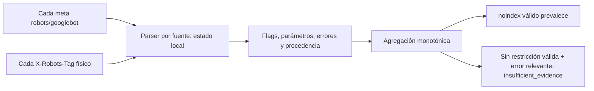

# Parser robots V4 — candidato final de fuentes independientes

**Continuación del 12 noviembre:** el controlador ya ejecutó y vinculó al parche `7a5a7066…` las 169 unitarias SEO, 13 de integración y TLS local sobre los nueve hashes exactos. Claude aceptó ese recibo solo como QA aislado. La integración sigue bloqueada: Codex no completó su propuesta en los intentos de 90/180 segundos, y contraste/defensa y recibos de restricciones siguen pendientes. No aplicar ni ejecutar el crawler. [Cierre incremental y evidencias](../../rhino-performance/indexability-20261112/site-continuation/coverage-closure/README.md). El texto siguiente conserva la entrega anterior; su condición «falta QA del controlador» queda actualizada únicamente por este recibo.

**Estado: probado en aislamiento; sin aplicar; integración bloqueada por el consejo.**

Parche único: [v4-robots-sources-final.patch](../v4-robots-sources-final.patch), 58469 bytes.

SHA-256: `7a5a7066bb22d2f87c18286100a9fba0ce76e50e53a8cf9b211821d0eba8b4a0`.

No apilar parches anteriores. La aplicación directa sobre una copia nueva de la base produjo los nueve hashes del árbol probado. Las seis preimágenes del workspace y los tres tests ausentes siguen intactos; AGENTS.md conserva su hash.

## Causa raíz y decisión

El extractor y el transporte ya conservaban listas de etiquetas/cabeceras. google_directives() las convertía en una cadena con comas antes de analizar. Ahí desaparecían los límites: una comilla de la primera fuente podía consumir texto de las siguientes. Ahora se analiza cada fuente física por separado y solo se agregan flags/errores interpretados.

Cada fuente conserva tipo/nombre/ordinal/hash, alcance, parámetros y errores sin duplicar su texto. Un valor entrecomillado no se vuelve un flag. La lectura alternativa de comas y la gramática de separadores desconocida solo producen incertidumbre; nunca flags válidos. Una lista reconocida de otro agente mantiene su ámbito. index no neutraliza noindex ni borra errores de otra fuente.

El clasificador y el auditor usan evidencia tipada. La vista heredada es solo presentación; el gate no interpreta valores de parámetros como subcadenas restrictivas. Los reportes heredados quedan conservadoramente unknown si falta evidencia; una restricción válida posterior no queda ocultada por unknown.

La incertidumbre ante sintaxis no soportada es política conservadora de IA-Ipanema. La documentación oficial combina fuentes y restricciones, pero no define aquí una recuperación exhaustiva de todos los valores malformados. No se afirma imitar el renderizado o la indexación de Google. Fuentes verificadas antes de escribir: [robots meta/X-Robots-Tag](https://developers.google.com/search/docs/crawling-indexing/robots-meta-tag), [noindex](https://developers.google.com/search/docs/crawling-indexing/block-indexing).

## Pruebas reales locales

- Dos fallos originales reproducidos antes sobre el hash bloqueado 4369d84d…; pasan después.
- Contraejemplos C1–C3 y posteriores de Claude: reproducidos antes y cubiertos por casos nuevos.
- 85 específicas incluidas en 169 unitarias SEO, 13 integración, TLS real en loopback y la suite SEO existente aprobadas.
- 396 unitarias generales aprobadas en la copia con fixture de conocimiento histórica mínima. No hubo nuevo discovery.
- Artefacto único aplicado a otra copia nueva con cero fuzz; hashes finales iguales al árbol probado.
- La primera pasada con caché y la pasada sin la fixture KnowledgeTests fueron fallos, están archivadas y no se aceptaron. Una expectativa anterior de candidato se fortaleció a unknown cuando hay gramática opaca, manteniendo el assert separado noindex=False.

Estos resultados son ejecuciones reales del autor/principal en copia aislada. El consejo exige además un recibo del controlador vinculado al árbol candidato; esos resultados no se etiquetan como tal recibo ni como revisión independiente. No hay QA posterior a integración porque no se aplicó al workspace.

## Archivos propuestos

Se reutilizan seis módulos actuales:

- `tools/ipanema/seo/robots.py`
- `tools/ipanema/seo/indexability.py`
- `tools/ipanema/seo/page_audit.py`
- `tools/ipanema/seo/crawl_policy.py`
- `tools/ipanema/seo/crawler.py`
- `tools/ipanema/seo/regression.py`

Se incorporan tres archivos de pruebas:

- `tests/unit/test_seo_review_additional_v4.py`
- `tests/unit/test_seo_robots_sources_v4.py`
- `tests/unit/test_seo_robots_values_v4.py`

Sin cambios a temas, producción, AGENTS.md, modelos, permisos, dependencias ni mecanismo del consejo.

## Revisión independiente y bloqueos

Claude revisó de nuevo el diff completo de este hash y, por inspección, no encontró falsos negativos críticos en el tratamiento de noindex. No lo aprobó: falta el recibo QA del candidato emitido por el controlador y Codex no completó intervención por inactividad. El circuito se abrió tras dos fallos; no se simula su participación ni se reutilizan aprobaciones de otro hash. [ADR real](../../runs/rhino-performance/20261111T184755-orchestration-66d74a17/council/adr.json).

Consejo: needs_evidence, implementation_allowed=false, sin objeciones/defensas completas. La revisión técnica del principal [Codex](codex-technical-review.md) es auto-revisión, no sustituye al participante independiente ni es otro voto. El candidato queda sin aplicar y no se solicita autorización para saltar estas condiciones.

Observaciones medias restantes: granularidad conservadora del gate; volumen de evidencia; consumidores externos de la vista textual. El diagnóstico sintético de 200000 átomos (800000 caracteres) produjo 14572662 bytes de evidencia JSON en 0,206 s y pico RSS de 109824 KiB en esa ejecución. Es una medición del proceso local, no LCP/INP ni rendimiento de una tienda. [Diagnóstico](revision3/evidence-size-diagnostic.json).

Límites adicionales: agentes inválidos ajenos en robots.txt generan warnings sin borrar reglas válidas; errores que puedan afectar a Googlebot/IA/wildcard siguen bloqueando conservadoramente. NAT64 con IPv4 pública también queda excluido por política; no se probó topología real. Las gramáticas desconocidas pueden reducir candidatos a unknown.

## Matriz de objeciones

| ID | Objeción | Evidencia | Estado local / aceptación |
|---|---|---|---|
| prior-O1 | max-image-preview:none produce falso noindex | `test_O1_preview_none_is_not_noindex; test_headers_multiple_and_scope` | regresión previa conservada y comprobada en suite actual; aceptación sujeta a revisión nueva · local evidence only; council acceptance blocked |
| prior-O2 | Selección de robots por subcadena en vez de product token | `test_O2_robot_product_token_not_substring; test_robots_merge_exact_groups_case_and_fallback` | regresión previa conservada y comprobada en suite actual; aceptación sujeta a revisión nueva · local evidence only; council acceptance blocked |
| prior-O3 | Exclusiones críticas perdidas tras truncar 2000 filas | `test_O3_late_exclusion_partial` | regresión previa conservada y comprobada en suite actual; aceptación sujeta a revisión nueva · local evidence only; council acceptance blocked |
| prior-O4 | max_urls puede ocultar URLs del sitemap sin verificar | `test_O4_unchecked_sitemap_partial` | regresión previa conservada y comprobada en suite actual; aceptación sujeta a revisión nueva · local evidence only; council acceptance blocked |
| prior-O5 | Palabra comprar en contenido editorial tratada como acción | `test_O5_editorial_action_word_allowed` | regresión previa conservada y comprobada en suite actual; aceptación sujeta a revisión nueva · local evidence only; council acceptance blocked |
| prior-A1 | Ciclo de redirects del sitemap descartado sin error | `test_sitemap_redirect_cycle_not_complete` | regresión previa conservada y comprobada en suite actual; aceptación sujeta a revisión nueva · local evidence only; council acceptance blocked |
| prior-A2 | Límite de redirects del sitemap descarta destino sin marcar parcial | `test_sitemap_redirect_limit_not_complete` | regresión previa conservada y comprobada en suite actual; aceptación sujeta a revisión nueva · local evidence only; council acceptance blocked |
| prior-A3 | Enlaces de página sitemap-only quedan sin HTTP pero complete=True | `test_disconnected_sitemap_outgoing_required_unchecked` | regresión previa conservada y comprobada en suite actual; aceptación sujeta a revisión nueva · local evidence only; council acceptance blocked |
| prior-A4 | NAT64 global puede incorporar IPv4 privada | `test_dns_transition_prefix_private_not_accepted` | regresión previa conservada y comprobada en suite actual; aceptación sujeta a revisión nueva · local evidence only; council acceptance blocked |
| prior-A5 | Sufijos y parámetros de ruta comerciales pasan el filtro | `test_commercial_suffix_and_matrix_routes_excluded` | regresión previa conservada y comprobada en suite actual; aceptación sujeta a revisión nueva · local evidence only; council acceptance blocked |
| prior-A6 | Espera del scheduler agota deadline antes de iniciar request | `test_deadline_rechecked_after_scheduler_delay` | regresión previa conservada y comprobada en suite actual; aceptación sujeta a revisión nueva · local evidence only; council acceptance blocked |
| prior-S1 | HTTP GET, certificado/SNI y ausencia de Cookie/Authorization | `tls_fixture.LocalTLS; TransportV4` | regresión previa conservada y comprobada en suite actual; aceptación sujeta a revisión nueva · local evidence only; council acceptance blocked |
| prior-S2 | Mismo origen HTTPS y rutas privadas tras decodificación | `test_domain_schemes_and_actions_in_query; test_actions_private_multiencoded_and_ambiguous; test_redirect_to_private_external_never_requested` | regresión previa conservada y comprobada en suite actual; aceptación sujeta a revisión nueva · local evidence only; council acceptance blocked |
| prior-S3 | 403/429/challenge y robots desconocido detienen operaciones | `test_403_429_stop_from_sitemap_no_home; test_robots_unreachable_and_challenge_no_crawl` | regresión previa conservada y comprobada en suite actual; aceptación sujeta a revisión nueva · local evidence only; council acceptance blocked |
| prior-S4 | Transferencia, gzip, presupuesto y DNS fijado | `tests/unit/test_seo_transport_v4.py; PolicyV4.test_permissions_limits_stop_and_rate` | regresión previa conservada y comprobada en suite actual; aceptación sujeta a revisión nueva · local evidence only; council acceptance blocked |
| prior-A7 | Regresión v2: acciones con sufijos admitidas (/add-to-cart-123, /comprar-ahora) | `test_action_prefix_suffix_regression` | regresión previa conservada y comprobada en suite actual; aceptación sujeta a revisión nueva · local evidence only; council acceptance blocked |
| prior-A8 | PRIVATE deja pasar delimitadores como checkout-step y cart,1; acción addtocart compacta | `test_private_prefix_delimiters_and_action_compact` | regresión previa conservada y comprobada en suite actual; aceptación sujeta a revisión nueva · local evidence only; council acceptance blocked |
| prior-A9 | Location ausente debe producir error explícito en home, sitemap y robots | `test_missing_location_is_explicit_error` | regresión previa conservada y comprobada en suite actual; aceptación sujeta a revisión nueva · local evidence only; council acceptance blocked |
| prior-A10 | Registro de parser sin source no debe lanzar KeyError ni completar inventario | `test_malformed_sitemap_parser_record_fails_closed` | regresión previa conservada y comprobada en suite actual; aceptación sujeta a revisión nueva · local evidence only; council acceptance blocked |
| prior-A11 | User-agent con versión en robots no debe quedar silenciosamente permitido | `test_invalid_robots_agent_with_version_fails_closed` | regresión previa conservada y comprobada en suite actual; aceptación sujeta a revisión nueva · local evidence only; council acceptance blocked |
| S01 | Meta robots válido | `test_01_valid_meta_robots` | corregido en candidato; no aplicado · local evidence only; council acceptance blocked |
| S02 | X-Robots-Tag válido | `test_02_valid_header` | corregido en candidato; no aplicado · local evidence only; council acceptance blocked |
| S03 | Fuentes independientes robots/googlebot/meta duplicados | `test_03_independent_meta_sources` | corregido en candidato; no aplicado · local evidence only; council acceptance blocked |
| S04 | Comilla abierta en meta: unknown si no hay restricción válida | `test_04_open_meta_without_valid_restriction_unknown` | corregido en candidato; no aplicado · local evidence only; council acceptance blocked |
| S05 | Comilla abierta en cualquier ámbito del header: unknown sin restricción válida | `test_05_open_header_without_valid_restriction_unknown` | corregido en candidato; no aplicado · local evidence only; council acceptance blocked |
| S06 | Noindex válido después de fuente malformada | `test_06_valid_restriction_after_malformed_source` | corregido en candidato; no aplicado · local evidence only; council acceptance blocked |
| S07 | max-image-preview:none no es noindex | `test_07_preview_none_not_restriction` | corregido en candidato; no aplicado · local evidence only; council acceptance blocked |
| S08 | Valores con noindex no son directivas | `test_08_quoted_values_not_flags` | corregido en candidato; no aplicado · local evidence only; council acceptance blocked |
| S09 | Agente y comillas reiniciados por cabecera | `test_09_header_scope_resets_for_each_field` | corregido en candidato; no aplicado · local evidence only; council acceptance blocked |
| S10 | Prefijos de agente y nombres dentro de valores | `test_10_agents_and_quoted_agent_names` | corregido en candidato; no aplicado · local evidence only; council acceptance blocked |
| S11 | Index no neutraliza restricción | `test_11_index_never_neutralizes_noindex` | corregido en candidato; no aplicado · local evidence only; council acceptance blocked |
| S12 | Desconocidas completas vs incompletas | `test_12_unknown_complete_and_incomplete` | corregido en candidato; no aplicado · local evidence only; council acceptance blocked |
| S13 | Defecto original: meta abierto oculta header | `test_original_meta_quote_cannot_mask_header_noindex` | corregido en candidato; no aplicado · local evidence only; council acceptance blocked |
| S14 | Defecto original: header abierto oculta siguiente | `test_original_repeated_header_quote_cannot_mask_next` | corregido en candidato; no aplicado · local evidence only; council acceptance blocked |
| S15 | Evidencia conserva fuentes, hash, errores y ordinal | `test_independent_errors_and_provenance_retained` | corregido en candidato; no aplicado · local evidence only; council acceptance blocked |
| S16 | Consumidores no usan texto unido para decisiones | `test_never_uses_legacy_joined_string_for_decision; test_legacy_page_audit_gate_does_not_parse_display_substring` | corregido en candidato; no aplicado · local evidence only; council acceptance blocked |
| S17 | Noindex monotónico ante permutación de fuentes | `test_valid_restriction_is_monotonic_across_sources` | corregido en candidato; no aplicado · local evidence only; council acceptance blocked |
| S18 | Acciones incrustadas mantienen exclusión de base | `test_prior_embedded_action_objection_closed` | corregido en candidato; no aplicado · local evidence only; council acceptance blocked |
| R01 | Política conservadora ante agente inválido en robots.txt | `test_unrelated_invalid_robots_agents_are_warned_not_global_abort; test_invalid_robots_agent_with_version_fails_closed` | corregido para agentes inválidos ajenos: warnings; errores relevantes para Googlebot/IA/wildcard se conservan · local evidence only; council acceptance blocked |
| R02 | Aprobación/revisión independiente del hash actual | `nuevo consejo Claude/Codex` | Claude completó revisión sin hallar falsos negativos críticos; Codex no completó; falta recibo QA del controlador · bloqueante: no aplicar ni solicitar integración todavía |
| C1 | Ámbito malformado de otro bot no puede aprobar Googlebot | `test_peer_C1_malformed_other_agent_scope_unknown` | contraejemplo reproducido antes; pasa en revisión 2 aislada · local evidence only; council acceptance blocked |
| C2 | Namespace/parametro ambiguo no aprueba si puede ocultar noindex | `test_peer_C2_ambiguous_namespace_unknown` | contraejemplo reproducido antes; pasa en revisión 2 aislada · local evidence only; council acceptance blocked |
| C3 | Lecturas por coma/comillas discrepantes: desconocido, no flag | `test_peer_C3_quoted_comma_restriction_is_unknown_not_flag` | contraejemplo reproducido antes; pasa en revisión 2 aislada · local evidence only; council acceptance blocked |
| C4 | Separadores de acciones %20, + y ~ conservan bloqueo de base | `test_peer_action_separator_regressions` | contraejemplo reproducido antes; pasa en revisión 2 aislada · local evidence only; council acceptance blocked |
| C5 | Reportes heredados sin procedencia tipada dan unknown explícito en gate | `test_legacy_gate_marks_unknown_explicitly` | unknown explícito legado; restricción posterior bloquea sin que unknown oculte el fallo · local evidence only; council acceptance blocked |
| D1 | Gate noindex posterior prevalece sobre unknown del baseline | `test_peer_gate_restrictive_after_cannot_be_only_unknown` | contraejemplo reproducido antes; pasa con candidato final aislado · local evidence only; council acceptance blocked |
| D2 | Lista válida de otro agente no pierde su alcance entre comas | `test_peer_valid_other_agent_list_is_not_uncertain` | contraejemplo reproducido antes; pasa con candidato final aislado · local evidence only; council acceptance blocked |
| D3 | Comillas con espacios y punto y coma sin gramática reconocida quedan inciertas | `test_peer_quoted_separator_grammar_unknown` | contraejemplo reproducido antes; pasa con candidato final aislado · local evidence only; council acceptance blocked |
| D4 | Agentes inválidos ajenos no impiden reglas válidas de Googlebot/IA | `test_unrelated_invalid_robots_agents_are_warned_not_global_abort` | contraejemplo reproducido antes; pasa con candidato final aislado · local evidence only; council acceptance blocked |
| P1 | Recibo QA del árbol candidato vinculado al controlador/consejo | `ADR independiente final y diagnósticos documentados` | pendiente bloqueante; no reemplazar por reporte del autor · pendiente; no se convierte en aprobación por promedio |
| M1 | Granularidad de gate noindex frente a estados globales desconocidos | `ADR independiente final y diagnósticos documentados` | observación media abierta; comportamiento conservador · pendiente; no se convierte en aprobación por promedio |
| M2 | Volumen de parámetros/desconocidos/errores sin tope específico | `ADR independiente final y diagnósticos documentados` | observación media abierta y medida; metadata sintética de 800000 caracteres produce 14572662 bytes JSON · pendiente; no se convierte en aprobación por promedio |
| M3 | Cambio semántico de vista legacy google_directives a flags | `ADR independiente final y diagnósticos documentados` | consumidores de tools/tests inspeccionados; consumidores externos no certificados · pendiente; no se convierte en aprobación por promedio |

## Integridad e historial

[Manifiesto y hashes](manifest.json) · [QA del último candidato](revision3/validation.json) · [Matriz JSON](objections.json) · [CSV](objections.csv) · [Decisión original](ADR-004.md) · [Adenda final](revision3/ADR-addendum.md).

Historial preservado: parche bloqueado 4369d84d…; primer candidato de fuentes a92a800a… archivado como review1; revisión 467b97cc… archivada como review2. Sus revisiones no autorizan el hash actual. También se conservan sus pruebas fallidas y resultados de consejo.

Respaldo privado del alcance: `.local/backups/seo-v4-sources-final-20261111T184829Z.tar.gz`, SHA-256 `ff0eaa95e1dbd1750256848660feacd83cb621b6836bb18da4e6d367cb462aa2`, modo 0600, ignorado por Git y verificado. Contiene las seis preimágenes completas y permisos, los tres marcadores de ausencia y el parche exacto. No se restauró nada porque hubo cero aplicaciones.

Preservación: 1062 archivos ajenos comprobados, cero diferencias. No se ejecutó crawler externo, no se conectaron cuentas y no se tocaron RHINO, DaMar ni producción.

Para continuar: completar intervención original de Codex y el QA formal del controlador para este hash; cerrar condiciones/observaciones obligatorias del consejo. Solo entonces solicitar autorización nueva del hash y aplicar mediante attempt/backup con QA posterior. No se cambia la política para conseguir aprobación.

## Continuación del 12 noviembre — Codex recuperado, V4 aún pendiente

Se recuperó únicamente la propuesta faltante de Codex y se completaron contraste y defensas con Claude. El ADR conserva needs_evidence y implementation_allowed=false; no se integra el parche 7a5a7066. El controlador reprodujo reservas sobre precisión del gate y expansión de evidencia. [Diagnóstico, respuestas y condiciones](../../rhino-performance/indexability-20261112/site-continuation/coverage-closure/codex-recovery/README.md). No hubo cambios al motor, tema ni producción.

## Candidato incremental final — 12 noviembre

Los tres problemas técnicos de gate/evidencia/contrato están corregidos en aislamiento. Claude y Codex aprobaron el nuevo hash `611a5dac1e2767c0d331e42b06c60834e8a427c8bbc41671b9a81a8c977f3e2c`,11 archivos;191 unitarias SEO y13 integraciones aprobadas. El parche anterior se conserva intacto. Listo para solicitar autorización específica de integración LOCAL; no integrado ni autorizado para red. [Diff, recibos, riesgos y ADR](../../rhino-performance/indexability-20261112/site-continuation/coverage-closure/final-candidate/README.md).
