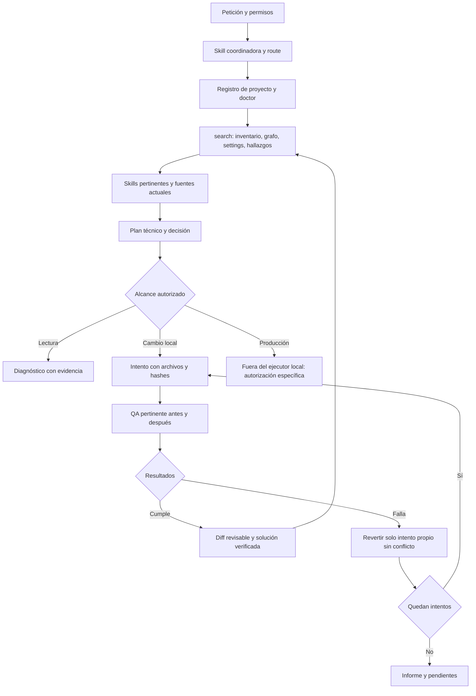

# Arquitectura de IA-Ipanema V2

La V2 funciona dentro del runtime de IA que abre el repositorio. AGENTS/skills orientan el trabajo de ingeniería y el CLI aporta operaciones comprobables; no es un servicio de inferencia independiente. El coordinador determinista selecciona candidatos y produce un plan que el agente debe contrastar con el código actual.

## Responsabilidades y fuentes

La coordinadora ipanema-storefront activa architect (contratos/consumidores), component-builder (schema/composición), seo-expert (HTML/rastreo), performance (carga/ejecución), responsive (cascada/layout), motion (efecto/coste), visual-qa (pruebas/comparación) y commerce (lógica nativa). No invoca subagentes ni presume paralelismo. Las skills enlazan las fuentes del discovery en vez de copiar sus contenidos.

`tools/ia.py` es la entrada; `tools/ipanema/` separa configuración/IO, recuperación, coordinación, validación, QA, comparación, transacciones, evaluación y soluciones. Los antiguos find_component/check_workspace conservan comandos compatibles y usan la implementación común. audit_source mantiene el extractor de schemas; browser_runtime y page_collectors sirven a los scripts anteriores y al nuevo runner. Los renderizadores reconstruyen el discovery y requieren precaución especial; no se ejecutan como QA ni actualizan hechos automáticamente.

## Conocimiento y vigencia

La búsqueda consulta JSON de componentes, settings, grafo e inventario, y Markdown seleccionado por consulta. Devuelve consumidores transitivos y referencias acotadas. No requiere índice persistente ni base vectorial. Fecha, proyecto de referencia y hash local se distinguen de verificación remota; un hash igual no demuestra el estado actual de producción.

findings.json conserva observaciones y recomendaciones históricas. reusable/solutions.json guarda soluciones con archivos y evidencia QA; su estado efectivo se recalcula al consultar. Un cambio de versión, archivo, prueba o tienda invalida la verificación correspondiente. Los contratos del catálogo no conceden derechos de redistribución.

## QA, control y límites

qa quick ejecuta validación de repositorio, unitarias, integración offline y diez evaluaciones del coordinador. QA navegador usa Chrome/Puppeteer/axe existentes y solo orígenes preparados. Se comparan PNG RGB/RGBA sin dependencias Python adicionales; máscaras y umbrales son explícitos. Lighthouse y Coverage son mediciones de laboratorio limitadas a esa navegación.

Las transacciones conservan el estado previo completo de archivos declarados, incluso cambios ajenos anteriores al intento. apply exige hash previo; aceptar/revertir exige hash posterior, y aceptar también evidencia QA posterior con los archivos medidos. No se ejecuta git reset/clean. El límite de intentos predeterminado es dos. Un conflicto posterior detiene todo el rollback; no se intenta adivinar qué parte de una edición ajena conservar.

Los niveles de autorización se aplican en AGENTS y en las operaciones del CLI. No es una frontera de sandbox contra cualquier herramienta de un runtime externo: el CLI V2 no expone publicación, pero un operador que use otras herramientas sigue sujeto a los permisos del usuario. No se registran razonamientos internos privados, solo petición, decisiones técnicas, fuentes, cambios y resultados.

Fuentes de integración revisadas el 2026-11-08: [skills de OpenAI](https://learn.chatgpt.com/docs/build-skills), [AGENTS.md](https://learn.chatgpt.com/docs/agent-configuration/agents-md) y [seguridad de GitHub Actions](https://docs.github.com/en/actions/reference/security/secure-use). CI usa permiso contents:read, checkout fijado y sin credenciales persistidas; no se conecta a tiendas.
